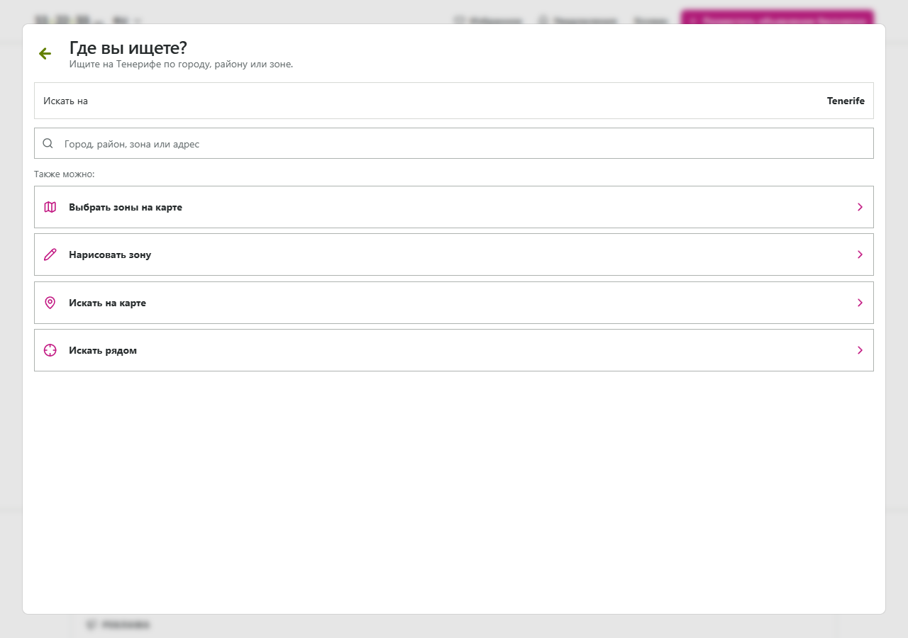

# Полный аудит проекта: провинциальный поиск, TOP, платежи и регрессии

**Дата:** 17 октября 2026, Europe/Moscow. **Рекомендация: NOT READY FOR RELEASE.**

Проверенная ветка: `codex/province-search-top`. Проверенный HEAD: `15b673864c28ec90c85e78f4cb37eedadfe982c2` — `Add province search and three-slot TOP capacity with countdown`. GitHub ref и локальный HEAD совпадают. Непосредственный baseline новых изменений: `1b2805e4`; изменен 41 файл, +861/−237 строк. В исходном master prompt названа прежняя `feature/payments-promotions-ads`; аудит выполнен по более свежей ветке, явно указанной пользователем.

Код приложения не изменялся. Коммиты, push, PR, merge и deploy не выполнялись. Созданы только этот отчет и изолированные материалы в `artifacts/audit-2026-10-17/`. Четыре существовавших untracked файла платежного аудита/скриптов сохранены. Production БД, реальные платежи и значения `.env` не использовались. PostgreSQL и Redis для проверок созданы отдельно от работающих контейнеров проекта.

## A. Краткая оценка для владельца проекта

**Последнее задание полностью не выполнено.** Присутствуют рабочие элементы: 52 провинциальных кода, фильтр SQL, серверная проверка обычной покупки, сохраненные резервы, независимость провинций, countdown с серверным временем. Однако интеграция имеет существенные дефекты.

| Вопрос | Вывод аудита |
|---|---|
| Корректен ли поиск по провинции? | Частично. Объявления с корректным индексом фильтруются; обычный импорт теряется целиком в provincial search/counts. Карта и alerts также имеют регрессии. |
| Корректно ли автоматическое определение? | Нет. Сервер доверяет переданному postcode; обычный UI отклоняет адрес Madrid ограничителем Tenerife. |
| Надежно ли ограничение три TOP? | Нет. Обычная конкурентная покупка защищена, но реальным API/SQL сценарием получены **4 активных TOP и 4 promoted результата в province 28**. |
| Работает ли sold-out countdown? | Проверенные UI сценарии работают: секунды, запрет покупки, clock skew ±24h, reload и revalidation при нуле. Полный live Google/Stripe/browser/DB путь не проверен. |
| Сохранен ли дизайн? | Нет для desktop location selector: сравнение с parent подтвердило замену большого светлого диалога узким высоким, другую палитру и исчезновение действий карты. Полный сайт визуально не сертифицирован. |
| Защищены ли платежи от несогласованных состояний? | Не полностью: admin может удалить оплаченную услугу, restore ложно возвращает успех; daily fulfillment не проверяет текущую блокировку владельца. |
| Подтверждены ли серьезные security проблемы? | Подтверждены нарушение географической границы доверия и финансовой целостности. Нового P0, подделки подписи Stripe или обычного захвата чужого аккаунта не установлено. |
| Есть ли блокеры релиза? | Да: нарушения поиска, адресного процесса, paid entitlement и основного ограничения TOP; обязательные backend gates не проходят. |

**Реестр содержит 10 уникальных подтвержденных дефектов: P0 — 0, P1 — 5, P2 — 5, P3 — 0.** Неоднозначности требований, неизвестное production состояние и непроверенные опасения в эти числа не включены. GEO/FE дубликат ограничения Tenerife объединен в FINDING-004.

Три главных риска: продажа четвертого TOP после финансового восстановления; исчезновение импортного каталога при новом поиске; выбор неверной провинции через неподтвержденный индекс и неработающий обычный mainland address flow.

### Что именно означает «8132 провинции»

Проект работает с Испанией. Официальная [инфографика INE España Municipal 2025](https://www.ine.es/infografias/infografia_censo.pdf) относит число **8132 к муниципалитетам**. [Справочник INE](https://www.ine.es/daco/daco42/codmun/cod_provincia.htm) содержит 50 провинций и коды Ceuta/Melilla: всего 52 провинциальных кода. Реализация использует именно эти 52 кода, а не 8132 муниципальных единицы. Муниципальный INE code и почтовый индекс — разные идентификаторы.

Это **не разрешенная аудитором замена требования**. Требуется бизнес-решение: три места на провинцию или на муниципалитет. Масштаб различается: 156 против 24 396 потенциальных мест. Пока оно не принято, нельзя утверждать полное соответствие исходному числу. Актуальная [страница муниципального справочника INE на 01.01.2026](https://www.ine.es/dyngs/INEbase/es/operacion.htm?c=Estadistica_C&cid=1254736177031&idp=1254734710990&menu=ultiDatos) также разделяет муниципалитеты и провинции.

Вторая неоднозначность: модель `User` не хранит адрес; фактический источник — **адрес недвижимости `Listing.postcode`**, а не зарегистрированный адрес владельца (`backend/app/models/__init__.py:37`, `:130`). Это логично для объявления, но исходная формулировка клиента сама по себе не подтверждает выбор. IP-геолокацией его не заменяли.

## B. Матрица соответствия требованиям

`PASS` ниже относится только к указанной исполненной проверке; статическое чтение само по себе не дает PASS. Частичность обозначена в статусе и ограничениях.

| Требование | Статус | Реализация | Метод проверки | Проблемы |
|---|---|---|---|---|
| Нужный административный уровень и 8132 единицы | NOT VERIFIED — неоднозначность | `spain_provinces.py`, `src/data/spain-provinces.json` | INE + подсчет каталога | 52 codes вместо 8132 municipios; нужно решение владельца |
| Поиск по провинции через backend | FAIL в интеграции | `repositories/listings.py:343`, `api/v1/listings.py:70` | Настоящие HTTP + SQL | Импорт Madrid: общий total=1, province total=0; FINDING-002 |
| Адрес автоматически определяет провинцию | FAIL | `schemas/listings.py:65`, `services/listings.py:277` | HTTP201, PATCH200 и UI | Postcode подменяется; Madrid UI rejected; 003/004 |
| Нет ручного city dropdown | PASS для UI; FAIL для запрета обхода | create/edit/publish + schema | Browser + прямой API | Dropdown убран, но запросом можно выбрать postcode любой провинции |
| Неполный/ошибочный адрес | FAIL | `ListingWrite`, `ListingPatch` | Исполненные schema/service probes | Пустой/garbage postcode принимается; TOP отказывает позже |
| Изменение адреса обновляет поиск | PASS для смены prefix без TOP; FAIL для верификации адреса | `listings.py:574`, `province_top.py:79` | HTTP PATCH и payment route tests | Можно сменить только индекс, оставив Madrid coordinates; активный/pending честный prefix move блокируется |
| Не более трех одновременных TOP | FAIL в полном lifecycle | `province_top.py`, `payment_finances.py:123` | PostgreSQL + signed webhook + public search | Финансовый rebuild создает четвертый; 001 |
| Независимая вместимость провинций | PASS в ordinary path | `province_top.py:51` | API: full28 и доступная08 | Не исправляет неверный источник province и finance bypass |
| Резервирование до Stripe IO | PASS для выполненных гонок | `payment_sessions.py:18` | Concurrent HTTP и DB | Unknown creation может удерживать capacity до оператора |
| Неоплаченная/failed покупка не активна | PASS в выполненных failure/late-payment probes; полное покрытие ограничено | `payment_fulfillment.py:64` | Mocks + API | Старые 17 TOP integration cases останавливаются до оплаты из-за blank postcode |
| Sold-out сообщение и HH:MM:SS | PASS в mock UI | `province-top-availability.tsx:43` | Browser320/1280 и отдельные probes | Нет сертификации всех сетевых/legacy состояний |
| Самый ранний доступный интервал | PASS в unit interval cases | `province_top.py:19` | Исполненные тесты окон | Учитывается весь срок и будущие резервы; это не всегда просто min(current expiry) |
| Ноль вызывает повторную проверку | PASS в mock UI | `province-top-availability.tsx:34` | Clock fast-forward, requests=2 | Checkout все равно окончательно проверяет backend |
| Refresh и client/server clock | PASS в mock UI | hook deadline от `serverNow`, `performance.now()` | Reload, clock±24h | Не измерялась точность при высоком network RTT/смене background state |
| TOP показывается в своей провинции | FAIL как полная гарантия | общий province SQL + promotion expression | API и source trace | Неверный postcode; четыре promoted; карта со старыми bounds |
| Legacy/import compatibility | FAIL | default postcode из migration0007; importer | Настоящий upsert и search | Нет backfill; новые imports тоже affected |
| Дизайн сохраняется | FAIL | `marketplace.tsx:204`, reused mobile CSS | Parent/HEAD screenshots | FINDING-007 |
| Hero и семь рекламных баннеров сохраняют свои правила | PASS для исполненных backend integration cases | homepage/commercial services | Реальные DB transactions, Stripe mocks | Это отдельные продукты, лимит3 к ним не применен; live payments не выполнялись |
| Ранее принятые security protections | PASS для ancestry/source и исполненных regression cases; не полная security certification | PR345/346/348 code | GitHub metadata, git ancestry, unit/integration | Native FFmpeg реальные тесты skipped; production deployment не проверен |

## C. Реестр подтвержденных дефектов

### FINDING-001 — Финансовое событие восстанавливает четвертый TOP

**Severity:** P1. **Функция:** paid TOP / capacity / financial restoration. **Происхождение:** нарушение нового трехместного инварианта через существующий административно-финансовый путь. **Уверенность:** высокая, реальный API/PostgreSQL reproduction.

**Location:** `backend/app/services/payment_finances.py:123`, `:154`; связанный вход `backend/app/services/admin.py:357`.

**Проблема:** capacity проверяется только при восстановлении `review_required`. Далее projection `ListingPromotion` безусловно пересобирается из fulfilled/normal orders. Если admin сократил projection, но order остался fulfilled, обычное финансовое событие расширяет projection без проверки места. Advisory lock сериализует операции, но пропущенное условие не заменяет.

**Воспроизведение:** (1) Оплатить TOP30d объявления с postcode28013; payment intent связан уже при исходном callback. (2) Авторизованным admin PUT сократить promotion до now+2s. (3) После expiry три других объявления оплачивают TOP в province28. (4) Доставить подписанный `charge.dispute.closed`; authoritative Stripe double возвращает исходный charge без refund и dispute=`won`. Это допустимый первый доставленный financial event при задержке предыдущих событий. (5) Повторный aggregate rebuild восстанавливает исходные30d.

**Ожидается:** максимум три; при недостатке capacity исходная покупка остается на review/compensation либо admin изменение согласовано с финансовым lifecycle. **Фактически:** webhook200, **databaseActiveTopCount=4**, **publicSearchPromotedCount=4** при `provinceCode=28`.

**Влияние:** четыре покупателя получают услугу, обещанную только трем; финансовые претензии. Не требуются подделка Stripe подписи или прямое изменение production БД. Нужны штатная admin операция и финансовое событие.

**Исправление:** проверять весь resulting interval перед любым расширением/возобновлением projection под capacity lock независимо от fulfillment label; согласовать legacy admin mutations с order state. При отказе — review, уведомление и управляемый refund.

**Regression test:** сохранить `test_confirmed_admin_shortening_then_normal_financial_event_overbooks`, ожидать <=3 и явный review; добавить normal snapshot, out-of-order dispute и повторный restore.

**Доказательства:** `artifacts/audit-2026-10-17/payment/overbooking-evidence.json`, `payment/integration/test_payment_routes.py`, `payment/routes-run.log`. Доказана и БД, и публичная видимость, а не только число скрытых строк.

### FINDING-002 — Провинциальный поиск исключает импортированные объявления

**Severity:** P1. **Функция:** import → search/cards/map/counts. **Происхождение:** новая интеграционная регрессия HEAD. **Уверенность:** высокая, реальный importer upsert + HTTP/SQL.

**Location:** `backend/app/spain_provinces.py:29`, `backend/app/repositories/listings.py:343`, `backend/app/api/v1/listings.py:74`; producers `backend/app/services/external_import.py:606`, `:868`.

**Проблема:** provider snapshot содержит canonical `province`, но constructor и `apply_primary_source_snapshot` не переносят ее в поле, используемое новым поиском. У imported Listing `postcode=''`. Общий фильтр определяет province исключительно regex/substr postcode. Это касается и новых импортов, а не только старых данных.

**Воспроизведение:** реальным `upsert` добавить допустимый Madrid item с `province='Madrid'`, `country='ES'` и Madrid coordinates, без выдуманного postcode; запросить `/listings/search/cards` без и с `provinceCode='28'`, затем `/listings/provinces/counts`.

**Ожидается:** проверенная structured province импортного объявления участвует в том же каталоге. **Фактически:** общий поиск200/total1/contains=true; Madrid200/total0; counts28=0; SQL province=NULL, snapshot province=Madrid.

**Влияние:** новая основная навигация скрывает обычный импортный каталог во всех провинциях с таким producer contract.

**Исправление:** единый canonical province source для owner и imported listings; импортам присваивать его из проверенной structured province, owner — из проверенного адреса. Backfill из существующих источников с явным unknown/review. Не подставлять фиктивный полный postcode.

**Regression test:** importer Madrid без postcode → cards/search/map/counts28 include,08 exclude; snapshot refresh и source failover сохраняют province; противоречивая география отклоняется.

**Доказательства:** `geography/database-output.json` keys GEO01, `geography/reproduce_geography_database.py`, `geography/database-run.log`; schema/service reproduction в `geography/reproduction-output.json`.

### FINDING-003 — Подмена postcode выбирает произвольную провинцию поиска и TOP

**Severity:** P1. **Функция:** адресная валидация и географическая граница доверия. **Происхождение:** permissive input существовал, но HEAD сделал его источником paid capacity. **Уверенность:** высокая, HTTP201/PATCH200 и owner TOP availability.

**Location:** `backend/app/schemas/listings.py:65`, `:196`; `backend/app/services/listings.py:277`, `:309`, `:574`, `:681`; `backend/app/services/province_top.py:38`, `:79`.

**Проблема:** postcode, street, city и coordinates принимаются независимо; нет server-side доказательства согласованного адреса. `apply_write` сохраняет ввод, `require_top_address_mutable` сравнивает лишь prefix. Литеральный лишний `provinceCode` запрещен schema, но реальный обход идет через postcode.

**Воспроизведение:** verified host создает объявление с фотографиями, cityMadrid, streetCalleMayor, coordinates40.4168/−3.7038 и postcode08001; затем меняет только postcode на29001. Для активного TOP аналогично можно оставить prefix, поменяв физический адрес/coordinates.

**Ожидается:** провинция определена из согласованного проверенного адреса; противоречие отклоняется. **Фактически:** create201 published/province08; availability=Barcelona/3slots; postcode-only PATCH200 делает province29/Málaga, сохраняя Madrid coordinates. Дополнительные schema/write probes принимают пустой/garbage postcode и дают provinceNULL.

**Влияние:** пользователь вручную направляет объявление и TOP в чужой географический пул, нарушает автоматическую адресную привязку и фактическую локальную эксклюзивность. Это не доказательство четвертой строки в одном сохраненном prefix bucket — такое доказательство отдельно в001.

**Исправление:** server-side validation полного effective address при create/patch, trusted province evidence и согласованность country/address/coordinates. Regex postcode сам по себе недостаточен. Защитить действующий и pending TOP от физической смены провинции с сохраненным старым prefix.

**Regression test:** Madrid+08001 rejected; consistent Madrid accepted; missing address controlled validation; физический move активного TOP rejected; честный move без TOP обновляет все проекции.

**Доказательства:** `geography/database-output.json` keys GEO02, реальный bearer/session auth без dependency override; `geography/reproduction-output.json` для incomplete inputs.

### FINDING-004 — Обычный выбор адреса Madrid отвергает ограничитель Tenerife

**Severity:** P1. **Функция:** публикация/редактирование, automatic address UI. **Происхождение:** неполная интеграция нового Spain scope со старым адресным lifecycle. **Уверенность:** высокая, browser input → prediction click с детерминированным Maps double.

**Location:** `src/components/publish-smart-address-autocomplete.tsx:270`, `:304`; `src/components/publish-exact-address-sync.tsx:109`, `:153`, `:265`; mount chain `publish-route-enhancers.tsx:6`, `publish-address-lifecycle.tsx:95`.

**Проблема:** native location enhancer расширен до Spain, но подключенный smart autocomplete/fallback по-прежнему ограничен `TENERIFE_BOUNDS` и `isInsideTenerife`. Он обслуживает обычное текстовое поле. Exact-address resolver также добавляет Tenerife к geocoder query. Новый штатный тест напрямую отправляет successful selected event и обходит эти проверки.

**Воспроизведение:** открыть `/#/publicar`, ввести `Calle Mayor 1, Madrid` в реальный `#publish-street`, выбрать валидную prediction с postal28013/cityMadrid/coordinates40.4168,−3.7038. Не dispatch synthetic success вручную.

**Ожидается:** provinceMadrid, postcode28013, markerMadrid. **Фактически:** «Не удалось открыть эту подсказку…», сохраняются provinceSantaCruzDeTenerife, postcode38678, cityAdeje, прежний markerTenerife.

**Влияние:** поддержка страны в реальном адресном процессе не завершена. Отдельный native event path способен принять Madrid; утверждать, что технически вообще нет ни одного рабочего пути, было бы неверно.

**Исправление:** согласовать scope всех реально подключенных native/smart/exact/fallback resolvers; сохранить оформление поля и дополнить backend validation из003.

**Regression test:** настоящий typing/prediction click для Madrid, LasPalmas, Balearics, Ceuta/Melilla; fallback без native widget; смена Tenerife→Madrid.

**Доказательства:** `frontend/flows-audit.mjs`, `frontend/flows-results.json`, `frontend/madrid-autocomplete-rejected.png`. Реальный Google API не вызывался; существующий coordinate guard исполнен в браузере.

### FINDING-005 — Admin удаляет оплаченный TOP, restore сообщает ложный успех

**Severity:** P1. **Функция:** admin promotion/paid entitlement/recovery. **Происхождение:** существующий финансово-административный дефект; HEAD не исправляет его интеграцию. **Уверенность:** высокая, API + PostgreSQL.

**Location:** `backend/app/services/admin.py:357`, `:385`, `:395`; `backend/app/services/payment_finances.py:277`.

**Проблема:** legacy PUT/DELETE promotion не согласован с paid/pending orders. DELETE удаляет projection, order остается paid/fulfilled/normal. Review queue его не показывает. Restore early return проверяет label, но не наличие услуги.

**Воспроизведение:** оплатить TOP30d → авторизованный `DELETE /admin/listings/{id}/promotion` → `/payments/admin/review-required` → `/payments/admin/orders/{order}/resolve`, actionrestore с reason.

**Ожидается:** controlled409 либо управляемые review/refund/restore с сохранением оплаченной услуги и audit trail. **Фактически:** DELETE200, promotion отсутствует; review queue пустая; resolve200 `resolved:true`, promotion по-прежнему отсутствует.

**Влияние:** потеря оплаченного периода и вводящий в заблуждение recovery. Освобожденная capacity/разрешенная смена адреса усиливают риск последующего восстановления. Это не unauthorized admin access: дефект в разрешенной admin операции.

**Исправление:** запретить несогласованные projection mutations оплаченного TOP либо использовать общий audited paid lifecycle. Early idempotent restore success допустим только после проверки соответствующего entitlement; иначе настоящая реставрация с capacity check.

**Regression test:** paid/pending PUT/DELETE →409 или явный review; restore реально создает/проверяет projection; повторный callback не дает ложной компенсации.

**Доказательства:** `payment/integration/test_payment_routes.py`, `payment/routes-run.log`, дополнительные mock probes; подробности в `payments-notes.md` PAY-002.

### FINDING-006 — Сохраненные провинциальные alerts продолжают искать по городу

**Severity:** P2. **Функция:** saved search/notifications. **Происхождение:** новая интеграционная регрессия. **Уверенность:** высокая, реальная сохраненная search и публикации в БД.

**Location:** `backend/app/services/notifications.py:157`, `:209`, `:267`; `backend/app/repositories/listings.py:343`; `backend/app/schemas/searches.py:84`; `src/contexts/app-context.tsx:590`.

**Проблема:** interactive query переводит province в `provinceCode`, но persisted search содержит query/filters/polygon без canonical scope. `_saved_search_payload` не восстанавливает province; backend применяет city/area ILIKE. Code-only URL может вообще потерять scope при сохранении.

**Воспроизведение:** сохранить provincial searchMadrid и включить alert; опубликовать подходящее Getafe с Madrid postcode и контрольное объявление cityMadrid.

**Ожидается:** оба запускают alert, Barcelona — нет. **Фактически:** оба включены в provincial interactive search; notification есть только для cityMadrid, Getafe не вызывает его.

**Влияние:** пользователь не получает ожидаемые предложения вне столицы провинции; сохраненная выборка не соответствует просмотренной.

**Исправление:** persist/validate/restore canonical geography в поисках и alerts. Мигрировать старые city searches осознанно, не переопределять их все как province.

**Regression test:** round-trip Madrid scope, Getafe includes/Barcelona excludes, generic `q=España&provincia=28`, restore URL и email/in-app notifications.

**Доказательства:** `geography/database-output.json` GEO03, `geography/database-run.log`, compiled SQL в `geography/reproduction-output.json`.

### FINDING-007 — Desktop location selector изменил утвержденный дизайн и потерял действия

**Severity:** P2. **Функция:** desktop search UI. **Происхождение:** непосредственно HEAD. **Уверенность:** высокая, parent/HEAD browser comparison.

**Location:** `src/components/marketplace.tsx:204`, `:205`; CSS `src/mobile-app-v2.css:181`, `:354`; shared `src/components/ui/dialog.tsx`.

**Проблема:** прежний `LocationSelector` заменен `DialogContent className='m2-location'` с mobile minimum100dvh и default max-width384px. Применен темный mobile list background. Из desktop входа исчезли действия выбора зон, рисования, поиска на карте и nearby.

**Воспроизведение:** одинаковый RU/mock viewport1280×900, homepage location selector на parent1b2805e4 и HEAD.

**Ожидается:** новая география в утвержденной оболочке/палитре с сохранением существующих действий. **Фактически:** parent x32/y34/1216×832 → HEAD x448/y0/384×900; list background rgb(32,32,32), изменены ширина, высота, отступы и состав элементов.

**Влияние:** нарушено явное условие сохранения дизайна; потеря альтернативных способов поиска. Допустимое обновление geographic wording не требует такой замены оболочки.

**Исправление:** вернуть established desktop wrapper и map alternatives, встроить province choices в него; scoped mobile styles вместо переноса mobile class на shared dialog.

**Regression test:** screenshot comparison к утвержденному parent на320/768/1280, размеры/overflow и доступность всех прежних действий.

**Доказательства:** `frontend/baseline-selector-1280.png`, `frontend/current-selector-1280.png`, `frontend/flows-results.json`; HEAD дополнительные screenshots320/768/1280.

### FINDING-008 — Карта провинции остается в предыдущем регионе

**Severity:** P2. **Функция:** province map search/navigation. **Происхождение:** новая province-интеграционная регрессия. **Уверенность:** высокая для camera, production query consequence прослежен статически.

**Location:** `src/components/mobile-app-v2.tsx:962`; `src/components/mobile-map-listings-layer.tsx:58`; `backend/app/repositories/listings.py:703`.

**Проблема:** camera resolver учитывает `comunidad`, но не новый `provincia`. При Madrid search он берет remembered Tenerife viewport; marker request добавляет visible bounds к province filter.

**Воспроизведение:** сохранить Tenerife camera под `112233:map-last-search-area:v2`, открыть `/#/buscar?q=Madrid&provincia=28&vista=mapa&alquiler=long`; контроль — Madrid `comunidad=13`.

**Ожидается:** camera новой явно выбранной провинции имеет приоритет. **Фактически:** province28 center28.278568/−16.809734 zoom8.58; community13 center40.525686/−3.81559 zoom8.38. Первый результат находится на Tenerife.

**Влияние:** заголовокMadrid над картой прежнего региона. Source trace показывает, что production query пересекает Madrid с Tenerife viewport и исключает Madrid markers до ручного pan. Последний HTTP/SQL E2E вывод отдельно не исполнен.

**Исправление:** province bounds/camera resolver и приоритет явной province над history; сохранить согласованные list/map criteria.

**Regression test:** Tenerife history → Madrid province → map center и реальные bounds marker request; затем back/forward и code-only URL.

**Доказательства:** `frontend/map-history-results.json`, `frontend/map-history-audit.mjs`, `frontend/madrid-map-history.png`.

### FINDING-009 — Daily TOP активируется после блокировки владельца

**Severity:** P2. **Функция:** payment confirmation → eligibility. **Происхождение:** существующая daily/legacy-monthly развилка, значимая для текущей продажи. **Уверенность:** высокая, PostgreSQL/API + отдельный function probe.

**Location:** `backend/app/services/payment_fulfillment.py:137`; полная функция `backend/app/services/homepage_purchase.py:23`; public visibility `backend/app/repositories/listings.py:311`.

**Проблема:** нынешняя покупка `days` создает order без `duration_months=1`. При подтверждении daily branch проверяет лишь published/is_external/deleted_at listing; текущие blocked/deleted owner, restrictions, фото и допустимость цены из `eligible()` пропускаются. Проверка initiation не защищает от изменения во время Checkout.

**Воспроизведение:** допустимый listing → TOP checkout → блокировка владельца и publish restriction в isolated DB, эквивалентные moderation state change → signed success callback.

**Ожидается:** актуальная eligibility; paid/review_required, если услуга уже недоступна. **Фактически:** promotion создан, order fulfilled, отправляется success notification; public query блокирует показ этому владельцу.

**Влияние:** деньги подтверждены за невидимую услугу и capacity занята. Публичную moderation выдачи этот путь не обходит — дефект именно в fulfillment/финансовом соответствии.

**Исправление:** единая eligibility для daily/monthly; отрицательный результат направлять в существующий review path; явно согласовать политику уже активных покупок при moderation.

**Regression test:** owner blocked, listing/user restriction, удаление медиа, изменение цены между initiation и callback → нет grant, есть review.

**Доказательства:** `payment/integration/test_payment_routes.py`, `payment/routes-run.log`, `payment/test_payment_audit_probes.py`.

### FINDING-010 — Ветка не проходит обязательные backend quality gates

**Severity:** P2. **Функция:** CI/regression validation. **Происхождение:** HEAD и неадаптированные contract fixtures. **Уверенность:** высокая, исполненные pinned Python checks. Это finding о проверяемости релиза; каждое падение не объявляется отдельной runtime уязвимостью.

**Location:** `backend/app/api/v1/listings.py:80`; import blocks `backend/app/repositories/listings.py:1`, `backend/app/spain_provinces.py:30`, `backend/tests/test_province_top.py:1`; tests `backend/tests/test_moderation_write_boundaries.py:28`, `backend/tests/test_province_top.py:142`, `backend/tests/integration/test_homepage_purchase.py:19`, `test_monthly_top_purchase.py:27`, `test_payment_audit.py:77`. Gates определены `.github/workflows/production-audit.yml`.

**Проблема и воспроизведение:** выполнить `ruff check app tests`, `mypy app`, unit suite и PostgreSQL integration suite на HEAD с текущим `backend/constraints.txt` graph. См. команды вG.

**Ожидается:** обязательные проверки проходят и достигают заявленных платежных сценариев. **Фактически:** Ruff3 import errors; Mypy2 errors у `counts=dict(result.all())`; unit2 failures; 17 integration TOP cases возвращают409 из-за пустого postcode fixtures еще до основной платежной проверки.

Unit failure moderation — mock `SimpleNamespace` не имеет `execute` после нового advertising lock, а не доказательство обхода restriction. Financial unit сравнивает expiration с более ранним captured now: присвоенный внутри `datetime.now()` может быть на1ms позже; это дефект временного assertion, не доказательство устойчивого overbooking. У него отдельное сильное доказательство в001.

**Влияние:** source ветка не готова пройти опубликованные release gates; существенная часть старого payment coverage перестала проверять платежи.

**Исправление:** минимально исправить typing/imports, адаптировать честные address fixtures, mock lock и deterministic clock assertions. Затем повторить gates и добавить новые API/DB regressions, а не ослаблять условия PASS.

**Regression test:** green exact-head pinned CI с real PostGIS, новые негативные probes должны ожидать исправленное поведение.

**Доказательства:** `ruff.log`, `mypy.log`, `backend-unit-elevated.log/xml`, `backend-integration.log/xml`. Отдельный initial Redis failure был ограничением env и устранен повторным тестом, в finding не включен.

## D. Технический разбор province/TOP и архитектуры

### Архитектура и границы

Frontend — React19/TypeScript/Vite, React Router HashRouter, Tailwind/Radix; server state и auth — contexts/API modules, transient map state — localStorage. Backend — FastAPI, async SQLAlchemy, PostgreSQL16/PostGIS, Alembic. Redis обслуживает rate limits/leases и failure buffer; media — private S3/MinIO; SMTP — transactional outbox/mail worker; отдельный external-listings worker. Платежи — Stripe Checkout, signed webhooks, authenticated status recovery, periodic reconciliation. Nginx/Traefik и immutable releases описаны в deploy/runbooks; runtime production конфигурация этим аудитом не удостоверялась.

Проверены entry points, routes/dependencies, listing schemas/repositories/services, importer/notifications, moderation, media/storage/outbound guards, payment/admin lifecycle, модели/миграции, client transport, map/publication/dialog components, test configurations и CI. Проверки охватывают проект шире latest diff; это не заявление о построчной сертификации каждого файла, 52 провинций, всех сторонних adapters или всех production настроек.

### Географическая модель и исполнение

1. Native/smart address selection собирает city/street/postcode/coordinates. Readonly province в форме вычисляется из первых двух цифр postcode.
2. API сохраняет эти поля отдельно в Listing; backend resolver принимает ровно пять ASCII digits и prefix01..52, но не доказывает реальность/согласованность адреса.
3. Public DTO отдает `provinceCode`, private street/postcode/exact fields остаются в owner/admin schemas. Добавление code не установило новую утечку полного адреса.
4. SQL `CASE`+regex+`substr(trim(postcode),1,2)` общий для search/counts/TOP. Это единая механика, но неверный canonical source для imports.
5. `provincia` URL и province-name query переходят в `provinceCode`; старый `comunidad` совместим. Saved search и camera не обновлены полностью.
6. Без валидного postcode public provincial filter исключает строку; TOP отвечает409. Принять listing без postcode и отказать только при monetization — несогласованный UX.

У province нет отдельного FK/verified field, нового backfill и expression index в HEAD нет. Старые записи по migration0007 по умолчанию имеют пустой postcode. Документ `docs/province-search-and-top.md` предупреждает о необходимости operator audit, но не выполняет его. Реальное число неклассифицированных/overbooked production listings неизвестно. Нельзя считать документационное предупреждение выполненной миграцией.

### Вместимость, окна и concurrency

`MAX_PROVINCE_TOP=3`. Вместимость считается по distinct listing id: renewals не занимают второе место. Учитываются active/scheduled promotion windows и unresolved orders `creating/pending`; окна полуоткрытые, exact expiry освобождает место. `next_available` ищет первый интервал нужной длительности, в котором все checkpoints допускают покупателя. Будущие schedules могут сдвинуть purchase time дальше ближайшего текущего expiry.

Обычный checkout, admin promote, fulfillment и financial entry points берут PostgreSQL transaction advisory lock с ключом `commercial-advertising:homepage-bottom`. Он общий для всех провинций, hero и рекламных баннеров и действует между DB sessions/instances. Order дополнительно блокируется `FOR UPDATE`. Резерв `creating` commit происходит до Stripe IO; network latency не держит этот lock.

Реальные concurrent HTTP/DB tests дали [200,409] при борьбе за последнее место, один order для одновременных повторов и один effective grant при трех callbacks. Однако **DB constraint на трехместную capacity отсутствует**: корректность зависит от проверки каждого пути. FINDING-001 показывает, почему общий lock без проверки недостаточен.

Честная смена prefix во время active/scheduled TOP или unresolved checkout отвергается, в том числе для связанных rooms при syncAddressGroup. Спуфинг физического адреса с прежним prefix и admin удаление projection остаются исключениями.

### Countdown и истечение

Owner-only availability endpoint возвращает province/capacity/available/availableSlots/availableAt/serverNow. UI использует разницу `availableAt−serverNow`, затем `performance.now()`, обновляет секунды и опрашивает каждые15s. Ноль вызывает новый fetch и самостоятельно не разрешает оплату. При unknown release (`availableAt=null`) выводится pending explanation без выдуманного таймера.

Выполненные UI checks подтверждают seconds, sold-out message/disabled button, zero-revalidation, reload и client clock±24h. Backend unit tests проверяют earliest expiry, exact boundary, schedules, renewals и legacy>3. Реальная DB проверка expiry освобождает slot без background удаления строки. Точный expiry во время provider IO, сильная network latency, background-tab suspension и malformed/null timestamp UI не исчерпывающе проверены.

Состояния archived/deleted/blocked не имеют единой доказанно согласованной capacity policy: current query учитывает promotion/order независимо от публичной visibility; paid deletion других ресурсов обычно guarded, но admin TOP deletion — исключение005. Необходимо явно решить, удерживать ли место при временной moderation и как компенсировать скрытый период.

### Performance и maintainability

Исполненного нагрузочного benchmark и production query plans нет. Подтвержденные особенности: regex/substr province expression не имеет нового expression index; counts группирует eligible catalogue; availability читает windows/order peers; один global advisory lock сериализует разные province и прочие рекламные товары. Это **риски масштабирования, не измеренные SLA нарушения и не дополнительные findings**.

Polling раз в15s, а не каждую секунду, ограничивает нагрузку; tick выполняется локально. API cursor pagination, bounded map markers/clusters, DB statement/lock budgets и индексы существующего каталога просмотрены; их базовые regression tests входят в прошедшие suites. Next step — EXPLAIN/нагрузка на представительном объеме и индекс по утвержденному canonical province; разделять locks только после доказательства независимости и правильного lock order.

## E. Платежи и безопасность

### Прослеженный платежный lifecycle

Server checkout валидирует владельца/eligibility, считает цену, резервирует capacity, сохраняет order, затем вызывает Stripe с idempotency key orderUUID. У TOP100 cents/day,10..365days; homepage hero6000 cents/calendar month; bottom banner3000 cents/calendar month. Client amount/currency не определяют сумму сервиса. Banner7 и hero1 — отдельные продукты.

Webhook проверяет HMAC/timestamp, точный integer amount, EUR, live/test environment и session/order association. Success page не активирует права. Paid fulfillment, owner status GET и worker recovery сходятся в одной функции; refund/dispute слой имеет durable inbox и authoritative receipt snapshots. Full refund/lost dispute revoke; partial/pending требуют review. Большинство обычных путей устойчивы, но001/005/009 нарушают согласованность.

### Обязательные сценарии A–J

| Сценарий | Статус и доказательство |
|---|---|
| A. Двое покупают последнее место | PASS обычного пути: concurrent API [200,409], PostgreSQL; не отменяет finance bypass001 |
| B. Оплата после expiry reservation | PASS против overbooking: provider expiry → resale трех → late paid → review_required без четвертого; автоматический refund не проверен |
| C. Повторный successful webhook | PASS: повторные/три concurrent callbacks дают один effective grant и notification |
| D. Browser закрыт после оплаты | PASS для backend recovery: worker получает paid snapshot и активирует без redirect/visit; настоящий browser close не нужен для этой проверки |
| E. Прямой API при full province | PASS: четвертый обычный checkout409; другая province независима |
| F. TOP истекает во время покупки | NOT VERIFIED для точного interleaving Stripe IO; отдельно DB expiry→capacity release PASS |
| G. Меняется province/address | FAIL как полная гарантия: honest active/pending prefix change409, но адресный spoof003 и admin005 нарушают полный contract |
| H. Crash до activation commit | PASS моделирования rollback/retry: exception перед commit оставляет pending/no grant; retry+duplicate создают один; hard kill процесса не выполнялся |
| I. Два workers одного event | PASS для независимых API DB sessions: row/advisory locks и один grant; отдельные OS worker процессы не запускались |
| J. Много быстрых checkout одного listing | PASS: один order/URL, deterministic Stripe double по UUID; настоящий Stripe network idempotency не выполнялся |

### Проверенные security границы и ограничения

- Auth использует Argon2 и HS256-only JWT с обязательными claims и persisted session validation; API ownership/admin allowlist проверяются сервером. Тесты auth, email, moderation, media, SQL search и payments выполнены в общих suites. Подтвержденного нового IDOR, SQL injection, XSS или forged-payment grant в этих проверках нет; это не исчерпывающая security certification.
- Refresh cookie HttpOnly/SameSite, origin check cookie mutations, bearer в памяти и CORS allowlist просмотрены. Upload decode/size/ownership и local storage path boundary присутствуют; production MinIO end-to-end тест не выполнялся.
- HTTPX outbound transport сохраняет проверенный IP до connect, bounds response size и redirects. Native video input ограничен protocols/formats; реальные FFmpeg regressions skipped из-за отсутствия binaries, так что функциональное сохранение этой части подтверждено не полностью.
- Rate limiting uses Redis и bounded process-local fallback. При Redis outage лимит не остается глобальным между workers; этот известный degradation не назван новым подтвержденным exploit.
- Secret values не открывались/не выводились. Clean-room secrets scan всей истории этим запуском не выполнялся. Отсутствие утечек всех секретов не удостоверяется.
- Production DB role, SSH, backups/offhost restore, CSP, browser egress, admin MFA и worker health не проверялись на сервере. Старый `docs/security/FINDINGS-REGISTER.md` описывает такие риски, но его старые статусы/счетчики не перенесены в новый подтвержденный реестр без повторной проверки.

**Отдельный operational risk:** неизвестный Stripe create outcome оставляет `creating` reserve; после23h он остается таким же, с `review_required`. Это сознательный safe failure, поскольку timeout не доказывает отсутствие charge/session. Три неизвестных результата могут надолго занять province до оператора. Нужны metrics/alerts/verified-abandon workflow и различение доказанного provider rejection от unknown outcome; опасно освобождать места только по локальному TTL. Это не включено как отдельная security vulnerability.

После отдельного явного разрешения пользователя выполнен online scan `npm audit --omit=dev --json` через `registry.npmjs.org`: **exit0, известных уязвимостей0** во всех severity categories. Исходный результат сохранен в `artifacts/audit-2026-10-17/npm-audit-approved.json`. Это проверка npm production dependencies по advisory database на момент запуска; dev dependencies и Python graph этим запуском не проверяются. Результат не отменяет подтвержденные application logic defects и отмеченное расхождение локальных tools с lockfile.

## F. Сохранение дизайна и история PR

GitHub metadata на момент аудита подтверждает:

| PR | Содержание | Состояние и связь с HEAD |
|---|---|---|
| [345](https://github.com/antony502189-max/Ttest/pull/345) | Dependency pins PyJWT/urllib3/source-map-js | merged15.10.2026; `ab1867a...` ancestor HEAD |
| [346](https://github.com/antony502189-max/Ttest/pull/346) | Outbound/video/Stripe boundaries, migration freeze, audit | merged; merge837a9221, head2f331d50 ancestor HEAD |
| [347](https://github.com/antony502189-max/Ttest/pull/347) | Approved banner carousel, owner promotion choice/calendar | merged; merge6689c826/head5af6702c ancestor HEAD |

Дополнительная integration ветка PR348 присутствует через merge45646036. Source diff HEAD относительно parent не меняет security transport/video/patched dependency files. Прохождение исторического CI из PR description не засчитывается текущей ветке. GitHub query workflow runs текущего SHA вернул пустой список **в рамках pull-request-triggered wrapper**, что не доказывает отсутствие всех типов workflows.

Baseline для новых визуальных изменений — parent1b2805e4, уже содержащий принятые347 и security integration. Сравнение со старым main до347 было бы некорректно.

FINDING-007 установлен screenshot comparison. Изменение labels на province и добавление sold-out message функционально необходимы; замена desktop wrapper, palette и удаление map alternatives этим не обоснованы. TOP dialog сохранил established class и в проверенных320/1280 не имел horizontal overflow; это локальная проверка, не доказательство равенства каждого пикселя.

HEAD province selector дополнительно осмотрен при320/768/1280×900. Baseline export получил403 для локальных Geist font assets из-за Vite allowlist, поэтому типографическая идентичность этим сравнением не удостоверяется; изменение wrapper dimensions/classes, palette и исчезновение map actions установлены независимо от шрифта. На768 зафиксирован document scrollWidth801 при viewport768; в текущем реестре он не выделен отдельным дефектом без независимой baseline локализации источника. Все страницы, hover/focus states, native devices, accessibility и полный golden suite не пройдены. Поэтому **полная визуальная эквивалентность не подтверждена**, а установленная desktop регрессия уже делает обязательный критерий FAIL.

## G. Выполненные тесты, результаты и ограничения

### Среда и воспроизводимость

Windows/PowerShell, Node24.19.0. Python3.12.14: `output/release-venv/Scripts/python.exe`; FastAPI0.141.1, SQLAlchemy2.0.51, Pydantic2.13.4, pytest9.1.1, Ruff0.16.1, Mypy2.3.0 соответствуют inspected constraints. `pip check` — успешно. PostgreSQL16/PostGIS16-3.4 image digest44126d...; отдельные БД `audit_not_live`, `audit_payment_extra`, `audit_geo_extra` на127.0.0.1:55439. Отдельный Redis на56379.

**Ограничение frontend environment:** существующий `node_modules` расходится с lockfile по части tools: Vite8.3.4 вместо lock8.1.5, oxlint1.88.0 вместо1.74.0, Playwright1.64.1 вместо1.61.1; TypeScript6.0.3 совпадает. Не выполнялась переустановка/изменение пользовательского окружения. Поэтому успешные local lint/build/browser результаты не объявляются clean `npm ci` certification. Microsoft Edge155 использован как Chromium executable; это не полный cross-browser прогон.

Sandbox Windows блокировал asyncio socketpair и локальный browser networking; первые процессы остановлены, проверки выполнены через разрешенный elevated execution в изолированной инфраструктуре. Обычный Playwright webServer readiness также timeout; существующие spec затем запущены на проверенном отдельно поднятом mock server, внешние HTTPS resources blocked. Эти инфраструктурные попытки не записаны как дефекты приложения.

### Команды и фактические результаты

Все лог-файлы ниже относительно `artifacts/audit-2026-10-17/`.

| Проверка | Команда/эквивалент | Фактический результат | Артефакт |
|---|---|---|---|
| Frontend lint + i18n | `node node_modules/oxlint/bin/oxlint`; `node scripts/check-i18n-source.mjs` | exit0, warnings React/hooks; i18n ok | `lint.log` |
| TypeScript | `node node_modules/typescript/bin/tsc -b --pretty false` | exit0 | `typecheck.log` |
| Frontend build | `node node_modules/vite/bin/vite.js build` | exit0; warning chunk>500kB | `build.log` |
| Production mock credential guard | `node scripts/check-production-bundle.mjs` | ok | `build.log` |
| Backend lint | `python -m ruff check app tests` | FAIL,3 import blocks | `ruff.log` |
| Backend types | `python -m mypy app` | FAIL,2 errors,109 source files | `mypy.log` |
| Unit/non-integration | `python -m pytest -q -m 'not integration'` | **786 passed,2 failed,7 skipped** | `backend-unit-elevated.log/xml` |
| Real PostgreSQL integration | `python -m pytest -q -m 'integration and not s3'` | **240 passed,18 failed**,188.23s | `backend-integration.log/xml` |
| Redis follow-up | `pytest -q tests/integration/test_storage_failure_redis.py` с отдельным Redis | **1 passed**,0.68s; устраняет один env failure предыдущего прогона | `redis-integration.log/xml` |
| Supply-chain static pins | `python scripts/check-supply-chain.py` | ok | `supply-chain.log` |
| Migration immutable/expand guard | `python scripts/check-migration-compatibility.py` | ok | `migration-guard.log` |
| Миграции новой БД | `python -m alembic upgrade head` только audit DB | exit0; schema parity integration прошел | `migrations.log`, suiteXML |
| Новые payment mock probes | pytest `payment/test_payment_audit_probes.py` | **5 passed**; часть утверждает наличие дефекта | `payment/probes-run.log` |
| Новые payment API/Postgres probes | pytest `payment/integration/test_payment_routes.py` | **8 passed**; три подтверждают дефекты, остальные защиту | `payment/routes-run.log` |
| Geography schema/service | `python artifacts/audit-2026-10-17/geography/reproduce_geography.py` | exit0, записаны нарушения адреса/import/alerts | `geography/reproduction-output.json` |
| Geography real API/SQL | `python artifacts/audit-2026-10-17/geography/reproduce_geography_database.py` | exit0; GEO01–03 подтверждены | `geography/database-output.json`, `database-run.log` |
| UI clock/layout | `node artifacts/audit-2026-10-17/frontend/ui-audit.mjs` | exit0;3 viewport sizes,+24h,zero | `frontend/ui-results.json` |
| UI address/design/reload | `node .../frontend/flows-audit.mjs` | exit0; Madrid reject,baseline comparison,−24h/reload | `frontend/flows-results.json` |
| Map history | `node .../frontend/map-history-audit.mjs` | exit0, подтвержден неверный camera center | `frontend/map-history-results.json` |
| Существующие province/owner browser specs | `node node_modules/@playwright/test/cli.js test --config artifacts/audit-2026-10-17/playwright.audit.config.ts` | **12 passed**,50.3s; original specs через isolated wrapper | `province-browser-verified-server.log`, `browser-results.json` |
| Online npm advisory scan | `npm audit --omit=dev --json` после явного разрешения пользователя | **exit0,0 известных уязвимостей**; dev dependencies исключены | `npm-audit-approved.json` |

Из18 initial integration failures **17** падают на новом требовании валидного postcode в старых TOP fixtures; оставшийся Redis env failure перепроверен успешно. Это не «18 финансовых уязвимостей». Общий integration suite целиком после Redis не повторялся, его исходный лог сохранен. Два unit failures разобраны в010. Негативные audit probes, проходящие потому, что воспроизводят баг, не засчитываются как PASS пользовательского требования.

Семь unit skips: три opt-in external route/source research, четыре требуют настоящих FFmpeg/FFprobe binaries (MP4/MOV/WebM и отсутствие network request decoder). S3/MinIO case не выполнялся. Полный frontend E2E/a11y/visual suite, реальные Google/Stripe, load tests, process restart и production deployment checks не выполнялись. Автоматически выдавать им PASS нельзя.

### Обязательная acceptance matrix T01–T30

| ID | Итог | Выполненное доказательство / предел |
|---|---|---|
| T01 address→provinceA | FAIL общей корректности | Честный prefix parser работает; Madrid+08001 проходит HTTP201 и становится08 |
| T02 moveA→B | PASS для честного postcode-only move безTOP; FAIL верификации | API patch200 меняет scope, но не сверяет реальный адрес;003 |
| T03 incomplete address | FAIL | Schema/write принимают empty/garbage postcode; controlled TOP409 лишь позже |
| T04 запрет manual city | FAIL как бизнес-правило | Dropdown hidden/readonly PASS browser; manual province steering via postcode003 |
| T05 zeroTOP→3slots | PASS | Real API probe |
| T06 oneTOP→2slots | PASS | Real API probe |
| T07 twoTOP→1slot | PASS | Real API probe |
| T08 threeTOP→unavailable | PASS ordinary path | Real API direct fourth409; общий invariant FAIL001 |
| T09 fullA/freeB | PASS | Real API province28/08 independent |
| T10 sold-out message | PASS mockUI |320/1280 browser, button disabled |
| T11 earliest expiry | PASS interval-unit cases | Разные expiry/schedules/exact boundary; backend known windows, не live provider |
| T12 countdown zero | PASS mockUI |4s→zero,fetch2,enable только после ответа |
| T13 concurrent final slot | PASS ordinary path | PostgreSQL concurrent HTTP [200,409] |
| T14 failed payment no active | PASS выполненных probes, полное старое покрытие ограничено | Failure/late path и callback logic;17fixtures не достигают основной проверки |
| T15 duplicate callback | PASS | Concurrent/repeated callbacks один grant |
| T16 refresh countdown | PASS mockUI | Browser reload fetches authoritative fixture |
| T17 client clock skew | PASS mockUI |±24h не меняют server-relative timer |
| T18 expiry releases slot | PASS | Real DB expiry→availability0→1; cleanup не нужен |
| T19 promoted listing moves | FAIL полной гарантии | Honest active/pending prefix patch409; physical address spoof и admin loss обходят модель |
| T20 request province manipulation | FAIL | Literal extra field forbidden, effective postcode spoof201/200 |
| T21 чужая promotion | PASS в проверенных ownership API cases | Existing integration ownership tests и owner-bound queries; admin authorization отдельна |
| T22 legacy listings | FAIL | Import/blank postcode не классифицируется; новых импортов это тоже касается |
| T23 homepage banner/hero | PASS backend проверенных cases | DB lifecycle/race/expiry; live provider не использован |
| T24 bottom ads | PASS backend проверенных cases | Seven-slot/reservation/payment/moderation suites |
| T25 existing search/pages | FAIL | Saved alerts006, map008, normal address004 |
| T26 design320/tablet/desktop | FAIL | Desktop parent comparison007; HEAD320/768/1280 осмотрен, полный сайт не сертифицирован |
| T27 late paid after reservation expiry | PASS безопасности + manual resolution | No overbook, paid/review_required; автоматический refund не проверен |
| T28 concurrent same event | PASS DB-session уровня | Три signed callbacks, один grant/notification; не отдельные OS processes |
| T29 restart activeTOP | NOT VERIFIED | Persistence в Postgres прочитана; фактический restart/hard kill не выполнялся |
| T30 full province direct purchase | PASS ordinary API | Direct checkout409; альтернативный finance путь FAIL001 |

Дополнительные checks: wrong postcode/coordinates, normal Madrid prediction, imported province consistency, saved-alert locality, admin delete/false restore, finance rebuild и remembered map camera. Они обязательны для исправления найденных integration gaps, хотя отсутствовали в исходной матрице.

## H. План исправлений по приоритету

| Шаг | Приоритет и файлы | Требуемое поведение | Зависимости / риск | Проверки |
|---|---|---|---|---|
| 1 | Бизнес-решение: province или municipio, address source | Однозначный canonical unit и источник адреса | До schema/backfill; иначе меняется рынок capacity | Согласовать примеры двух городов одной province и owner/property address |
| 2 | P1 `admin.py`, `payment_finances.py`, shared fulfillment | Ни один admin/financial путь не удаляет/расширяет paid entitlement вне общего lifecycle; capacity<=3 всегда | Высокий риск финансовых регрессий; сохранять service history и explicit review/refund |001/005 real Postgres regression, refund/dispute/out-of-order callbacks, concurrent restore |
| 3 | P1 schemas/listings, services/listings, importer, canonical geography | Server trust-boundary и единая province для imports/owner | Зависит от1; аккуратный reversible backfill, unknown quarantine; не выдумывать postcode |003/002 API/import/search/cards/map/counts, peer address sync, legacy dataset |
| 4 | P1 publication native/smart/exact address components | Spain scope на обычном input и fallback без нового дизайна | Согласовать с3; риск geocoder/address edits | Madrid/Canaries/Balearics/Ceuta/Melilla typing→prediction→persist |
| 5 | P2 daily `payment_fulfillment.py` | Текущая eligibility одинакова для всех TOP products | Review/refund после оплаты, не silently cancel |009 moderation/price/media changes during checkout |
| 6 | P2 saved search schema/frontend/notifications, province map camera | Scope сохраняется в alerts/restore и задает правильный viewport | Возможна новая expand-compatible migration; сохранить старые city searches |006/008 Getafe notifications, code-only URL, prior viewport/Back |
| 7 | P2 desktop `marketplace.tsx`, scoped CSS | Вернуть approved оболочку и map actions; необходимый province wording остается | Без глобальной palette/layout переработки | Parent golden320/768/1280, keyboard/focus/overflow |
| 8 | P2 tests/types/imports/CI | Все обязательные exact-head gates проходят, tests достигают новых правил | Не ослаблять assertions, не маскировать bugs | Ruff/Mypy/unit/PostGIS/Redis/S3 + province/owner/payment browser suites |
| 9 | Operational validation | Legacy data audit, monitoring unknown reserves/review/refund, production backup/rollback evidence | Отдельно от source fixes, никаких автоматических live charges | Read-only counts, rehearsed recovery, approved sandbox provider tests; load/EXPLAIN при реальном объеме |

Рекомендуются небольшие reviewable изменения по этим группам. Этот аудит их не реализует и не разрешает deploy. После исправлений финальный immutable SHA должен пройти pinned clean environment CI; пересчитать findings по реально закрытым regressions.

## I. Рекомендация по выпуску

**NOT READY FOR RELEASE.** Основание — исполненные нарушения основного трехместного инварианта, географического поиска/адресной привязки, оплаченных услуг и сохранения дизайна. Это более сильное основание, чем просто недостаток тестов.

Рабочие обычные concurrency/countdown/ownership пути полезны, но не компенсируют альтернативные entry points и integration failures. Для допуска нужны исправления001–005, обязательного design критерия007, совместимости поиска и quality gates; затем повторный audit exact final SHA с проверкой legacy data и оставшихся сценариев. Решения по8132 и источнику адреса должны быть зафиксированы владельцем продукта.

Свежий online advisory verdict для Python и npm dev dependencies, live Stripe/Google correctness, production role/backup/worker health, real FFmpeg/S3, нагрузка и полный visual/accessibility scope остаются непроверенными. Для npm production dependencies отдельный разрешенный online scan вернул0 известных уязвимостей. Исторические отчеты и зеленые отдельные tests не заменяют остальных доказательств.

### Завершение и указатель доказательств

Временные Vite servers4174/4185/4190 остановлены. Созданные этим аудитом PostgreSQL/Redis контейнеры удалены после проверок; рабочие контейнеры проекта не изменены. Для повторения DB probes потребуется снова создать отдельную audit-инфраструктуру и применить миграции. JSON, логи, тесты и screenshots сохранены.

- `artifacts/audit-2026-10-17/geography-notes.md` — source trace и реальные GEO probes.
- `artifacts/audit-2026-10-17/payments-notes.md` — payment lifecycle, A–J и exact reproduction.
- `artifacts/audit-2026-10-17/frontend-notes.md` — browser methodology и baseline/screenshots.
- `artifacts/audit-2026-10-17/*log`, `*xml`, `browser-results.json` — исходные результаты проверок.

Дополнение после ответа пользователя: первоначальный `npm audit` был заблокирован automatic approval review из-за передачи dependency metadata в registry.npmjs.org. После явного разрешения выполнена та же проверка; результат0 известных уязвимостей сохранен в `npm-audit-approved.json`. Реестр остается **P0=0,P1=5,P2=5,P3=0**, рекомендация **NOT READY FOR RELEASE** не меняется.
