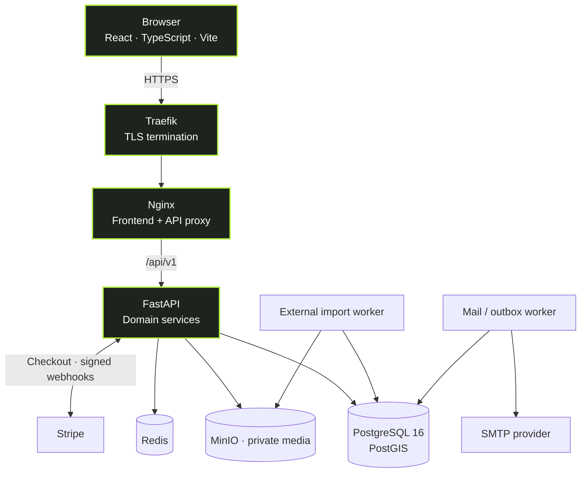

<div align="center">


<h1>112233.es</h1>

<h3>Find your place in Spain.</h3>

<p>A modern rental marketplace for <strong>Vivienda</strong> (long-term stays) and <strong>Turismo</strong> (holiday rentals), built around geographic discovery, a fast mobile experience, and straightforward listing management.</p>

<p><strong>Mainland Spain · Balearic Islands · Canary Islands</strong></p>

<p>
  <a href="https://app.112233.es"><strong>🌐 Open the website</strong></a>
  &nbsp; · &nbsp;
  <a href="#quick-start"><strong>⚡ Run locally</strong></a>
  &nbsp; · &nbsp;
  <a href="#release-from-github-actions"><strong>🚀 Deploy via GitHub</strong></a>
  &nbsp; · &nbsp;
  <a href="docs/deploy-quickstart-ru.md"><strong>🇷🇺 Инструкция по деплою</strong></a>
  &nbsp; · &nbsp;
  <a href="docs/index.md"><strong>📖 Documentation</strong></a>
</p>

<p>
  
  
  
  
  
  
</p>

</div>

---

### At a glance

| 🗺️ 17 regions | 🏡 2 rental modes | 📍 Geographic search | 💳 Paid promotion |
| :---: | :---: | :---: | :---: |
| Autonomous communities of Spain | Long-term and holiday stays | Google Maps + PostGIS | TOP, homepage, banners |

> [!IMPORTANT]
> **GitHub `main` is not the live deployment.** The production application runs on a self-hosted Contabo VPS, not GitHub Pages. Confirm the live version using [`/build-info.json`](https://app.112233.es/build-info.json) and the server's `/srv/112233.es/current` symlink before any operational change.

### New developer / release operator — start here

| Goal | Read / do |
| --- | --- |
| **Understand the project** | [Architecture](docs/architecture.md) → [API](docs/api.md) → [Documentation index](docs/index.md) |
| **Run the project locally** | [Quick start](#quick-start) → [Local development](docs/local-development.md) → [Testing](docs/testing.md) |
| **Submit changes** | Work in a feature branch → open a PR → wait for required CI → merge to `main`. Follow [Contributing](docs/contributing.md). |
| **Deploy to the real website** | Follow **[GitHub Actions deployment — short Russian guide](docs/deploy-quickstart-ru.md)**. An authorized operator launches the workflow and explicitly confirms production. No routine SSH access is needed. |
| **Diagnose a release** | [Release checklist](docs/release-checklist.md) → [Troubleshooting](docs/troubleshooting.md) → [Production operations](docs/production-operations.md) |

> [!CAUTION]
> **Do not push straight to `main` when preparing a production release.** The production workflow verifies that the target SHA belongs to a merged PR with passing required checks. A direct `main` commit may be rejected by that gate. Use a PR and merge it instead. Updating `main` during an already running release can also invalidate that release's SHA approval.

### Explore the project

[Features](#features) · [Technology](#technology) · [Architecture](#architecture) · [Payments](#payments) · [Quick start](#quick-start) · [Quality](#quality--testing) · [Operations](#production-operations) · [Documentation](#documentation)

---

## Features

| Experience | What it delivers |
| --- | --- |
| **🗺️ Search across Spain** | All 17 autonomous communities, municipality suggestions (approximately 8,130 place names), and region-specific counts filtered by the active search criteria. |
| **📍 Explore on Google Maps** | PostGIS-backed geographic filtering, bounded map markers/clusters, listing previews, and a remembered exploration zone across visits. |
| **🏠 Choose the right rental mode** | Separate **Vivienda** and **Turismo** experiences. Long-term listings have an inclusive **€1,000/month** ceiling; holiday prices follow separate rules. |
| **📸 Publish listings** | Owner publication, geocoded addresses, editable media galleries, images and video, moderation, and controlled visibility. |
| **❤️ Personalize discovery** | Favorites, discarded items, saved searches, viewing history, account settings and notifications. |
| **📢 Promote properties** | Paid TOP placement, a featured homepage property, and up to seven advertising-banner slots with approval flows. |
| **⚙️ Operate at scale** | External listing adapters, background mail processing, an admin dashboard, and server-side listing search with 50-row keyset pagination. |

<details>
<summary><strong>More about location and map behavior</strong></summary>

- The interface supports Spanish, Russian, and English region names.
- Typing `Barcelona` ranks **Cataluña** first; `comunidad=09` is the canonical Catalonia filter.
- `POST /api/v1/listings/regions/counts` uses the same visibility and active filters as the public listing feed.
- On a first mobile map visit, the default view covers mainland Spain and the Canary Islands. Later fresh visits restore the last explored virtual **70 km-radius** zone, adjusted to the screen. Bookmarked positions and in-app Back navigation follow their own priority rules.
- The site includes mainland Spain, the Balearic Islands and the Canary Islands; it is **not** a Tenerife-only application.

See [geographic search](docs/spain-regional-search.md) and [map navigation](docs/navigation-and-maps.md).

</details>

## Technology

| Layer | Technologies |
| --- | --- |
| **Web experience** | React 19 · TypeScript · Vite · React Router · Tailwind CSS |
| **Maps & geography** | Google Maps JavaScript API · PostgreSQL/PostGIS |
| **Backend API** | Python · FastAPI · Pydantic · async SQLAlchemy |
| **Persistence** | PostgreSQL 16 · Redis · private MinIO (S3-compatible) |
| **Payments** | Stripe-hosted Checkout · signed webhooks · payment reconciliation |
| **Background jobs** | Email outbox / SMTP worker · external listing-import worker |
| **Infrastructure** | Docker Compose · Nginx · Traefik · Contabo VPS |
| **Quality** | Pytest · Playwright · Ruff · Mypy · Oxlint · GitHub Actions |

## Architecture



The React application uses hash-based routes (`/#/...`); the API uses `/api/v1`. Authentication, ownership checks, listing visibility, payment decisions and price limits belong to the backend, not the browser.

**Production:** [app.112233.es](https://app.112233.es) on VPS `169.58.147.65`. Traefik is the public HTTP/HTTPS listener. PostgreSQL, Redis, MinIO and the FastAPI backend have no host-published public ports in the production Compose configuration. Deployed runtime state must be verified independently.

[System architecture →](docs/architecture.md) · [API reference →](docs/api.md) · [Database & migrations →](docs/database.md)

---

## Payments

The repository includes three Stripe Checkout purchase flows. **Availability in source does not establish that payments are active on production.**

| Product | Purchase model | After payment verification |
| --- | --- | --- |
| **⭐ Listing TOP** | 12h €0.99 · 24h €1.70 · 72h €4.50 | Activate/extend paid TOP for the exact purchased hours |
| **🏠 Featured listing** | One shared homepage position: 12h €4.95 · 24h €8.50 · 72h €22.50 | Activate the reserved featured-photo placement for exact paid hours |
| **📣 Advertising banners** | Up to seven slots, day-based campaigns | Enter administrator review; the approved period starts on approval |

**Financial safeguards in the implementation**

- Backend-owned prices and purchase eligibility; the success-page redirect never proves payment.
- Stripe webhook signature verification, durable order state, provider reconciliation and idempotency checks.
- Separate payment, fulfillment and financial states for exceptional orders, refunds and disputes.
- Administrator reconciliation and audited resolution of cases requiring manual review.

> [!WARNING]
> **Test payments are not harmless on a public marketplace.** Stripe test-mode transactions may grant real in-app promotional entitlements. Production test Checkout requires explicit `STRIPE_TEST_PAYMENTS_ENABLED` opt-in, which defaults to `false`. Live Checkout is separately guarded by `STRIPE_LIVE_PAYMENTS_ENABLED` (also `false` by default). Neither mode should be enabled without approved verification.

Store `STRIPE_SECRET_KEY` and `STRIPE_WEBHOOK_SECRET` **only in private server configuration**; they must be configured together and must never be exposed through `VITE_*` browser variables. The endpoint `POST /api/v1/payments/stripe/webhook` processes provider notifications. Do not use real financial operations as general smoke tests.

[Stripe Checkout guide →](docs/stripe-checkout.md) · [Advertising rules →](docs/homepage-advertising.md) · [Payment audit →](docs/payment-audit-fixes-2026-10-14.md) · [Migration compatibility →](docs/payment-release-compatibility-2026-10-14.md)

---

## Quick start

**Requirements:** Node.js **22+**, npm, Docker Compose, and Python **3.12+** if running FastAPI outside Docker. Windows users can use Docker Desktop and PowerShell. Use **development-only credentials**.

### 1. Clone and install

```bash
git clone https://github.com/antony502189-max/Ttest.git
cd Ttest

cp .env.example .env.local
npm ci
```

On Windows PowerShell, use `Copy-Item .env.example .env.local` instead of `cp`.

### 2. Start local dependencies and API

```bash
docker compose up -d postgres redis minio minio-init mailpit
docker compose up -d migrate backend mail-worker
```

### 3. Start the frontend

Set `VITE_API_BASE_URL=http://localhost:8000/api/v1` and `VITE_ENABLE_MOCK_MODE=0` in `.env.local`, then run:

```bash
npm run dev
```

Vite normally starts at **http://localhost:5173**. The real map requires an appropriately restricted Google Maps browser key. `VITE_ENABLE_MOCK_MODE=1` is for isolated frontend tests only.

| Local service | Address |
| --- | --- |
| Frontend | `http://localhost:5173` (typical) |
| FastAPI | `http://localhost:8000` |
| Swagger (development only) | `http://localhost:8000/api/docs` |
| PostgreSQL | `localhost:5432` |
| Redis | `localhost:6379` |
| MinIO API / console | `localhost:9000` / `localhost:9001` |
| Mailpit | `http://localhost:8025` |

<details>
<summary><strong>Optional: local sample data and Stripe sandbox</strong></summary>

Local sample data, **never production**:

```bash
docker compose --profile tools run --rm seed
```

To test Stripe, use the isolated [Stripe sandbox procedure](docs/stripe-local-sandbox.md), not production data. On Windows, Stripe CLI supplies the test webhook secret, `scripts/set-stripe-test-secrets.ps1` stores credentials in ignored `.stripe-test.secrets`, and `docker-compose.stripe-test.yml` runs with project name `ttest-stripe-test`. Its API binds to `127.0.0.1:18000` and it uses separate database volumes.

Never use live Stripe keys or production customer information in the sandbox.

</details>

For detailed setup, environment options and troubleshooting, see [Local development](docs/local-development.md) and [Configuration](docs/configuration.md).

## Quality & testing

**Frontend and security checks**

```bash
npm run lint
npm run typecheck
npm run build
npm run test:security
npm run test:bundle-security
```

**Browser and full-stack tests** (require appropriate test infrastructure)

```bash
npm run test:e2e
npm run test:fullstack
```

**Backend checks** (after installing `pip install -e "backend[dev]"`)

```bash
cd backend
ruff check app tests
mypy app
pytest -q -m 'not integration'
```

The complete infrastructure-backed local audit is `bash scripts/final-audit-local.sh` on Linux/WSL; it is **not** a production deployment script. Admin Listing regressions are available through `npm run test:admin-performance` (benchmark mode requires additional fixtures).

GitHub Actions covers production configuration, source snapshots, backend and frontend checks, mobile Playwright shards, publication/auth regressions and a dedicated [payment audit workflow](.github/workflows/payment-audit.yml).

GitHub Pages UI preview is **not** the production deployment target. A Pages setup failure should be diagnosed separately from the VPS release workflow; required CI gates must still be passing before a release.

> [!NOTE]
> Green CI proves only that its configured checks passed for the tested revision. It is **not** a production smoke test, comprehensive security assessment, or payment compliance certification.

[Testing handbook →](docs/testing.md) · [Security engineering rules →](docs/security-and-privacy.md) · [Security review findings →](docs/security/FINAL-SECURITY-REPORT.md)

---

## Production operations

### Release from GitHub Actions

The repository uses a **manual GitHub Actions release, followed by automated VPS deployment**. No production release is triggered by `push`, PR creation or merging alone.

1. **Merge a reviewed PR with passing CI into `main`**. Do not bypass the PR-based release evidence.
2. Open **[Production deployment (manual approval)](https://github.com/antony502189-max/Ttest/actions/workflows/manual-production-deploy.yml)** under GitHub Actions.
3. Click **Run workflow**, choose `main`, tick **I approve deployment of the current main to app.112233.es**, and start the workflow.
4. Wait for **Confirm exact main commit and passing PR CI** to succeed.
5. If the workflow says **Waiting for review**, open **Review deployments → production → Approve and deploy**.
6. Wait for **Deploy manually approved release to VPS** to succeed; compare the target SHA with [public build-info.json](https://app.112233.es/build-info.json) and test the changed functionality in a real browser.

**Self-approval:** In **Settings → Environments → production**, choose **Required reviewers** with the deploying operator listed and **disable Prevent self-review**. When Prevent self-review is enabled, a different designated reviewer must approve. Disabling Required reviewers removes the second click, but the initial manual Run workflow confirmation remains mandatory.

**Important:** a GitHub Actions green check, `main`, and the actually deployed VPS release are three separate things. Do not start another workflow, change `main`, or run manual backup/rollback while a deployment is active. The VPS runner requires an exact currently approved `main` SHA and uses a shared operation lock.

**[Полная инструкция на русском (пошагово)](docs/deploy-quickstart-ru.md)** · [English setup / key rotation](docs/manual-production-cicd.md) · [Release checklist](docs/release-checklist.md)

### Infrastructure and safety

Developers can release through GitHub Actions without routine root SSH access. The following server flow is executed **after the manually approved workflow**:

```text
Reviewed PR + passing required CI → merge to main
                                       ↓
GitHub Actions → Run workflow (main + explicit checkbox)
                                       ↓
Verify exact current main SHA and merged-PR checks
                                       ↓
Review deployments → Approve and deploy (if required)
                                       ↓
Restricted SSH → Contabo VPS → backup + release lock
                                       ↓
Immutable worktree → migrations → containers → smoke
                                       ↓
Green deploy + matching /build-info.json + manual UI check
```

The VPS release engine `deploy/deploy-release.sh <exact-origin-main-sha>` remains the controlled implementation and manual fallback for an authorized operator. It checks stateful image compatibility, backup freshness, PostgreSQL backup, migrations, application health and public build SHA. Application rollback **does not** reverse financial events or destructive data migrations.

Do not change `main` during an in-progress production release, start overlapping backups/deployments, remove persistent volumes, bypass the release lock, or share private SSH keys. Verify the live version using [`build-info.json`](https://app.112233.es/build-info.json) and the VPS current release; a successful PR CI run alone is not deployment evidence.

[Detailed deployment guide →](docs/deployment.md) · [Release checklist →](docs/release-checklist.md) · [Operations runbook →](docs/production-operations.md) · [Monitoring →](docs/production-monitoring.md)

---

## Documentation

| Area | Guides |
| --- | --- |
| **🏗️ System design** | [Architecture](docs/architecture.md) · [Frontend](docs/frontend.md) · [API](docs/api.md) · [Database](docs/database.md) |
| **🗺️ Geography and maps** | [Autonomous communities](docs/spain-regional-search.md) · [Navigation history](docs/navigation-and-maps.md) |
| **💳 Commerce** | [Stripe Checkout](docs/stripe-checkout.md) · [Advertising](docs/homepage-advertising.md) · [Payment sandbox](docs/stripe-local-sandbox.md) |
| **🛡️ Security** | [Engineering rules](docs/security-and-privacy.md) · [Security audit](docs/security/FINAL-SECURITY-REPORT.md) |
| **🛠️ Development** | [Local environment](docs/local-development.md) · [Configuration](docs/configuration.md) · [Testing](docs/testing.md) · [Contributing](docs/contributing.md) |
| **🚀 Infrastructure** | [GitHub deploy quickstart (RU)](docs/deploy-quickstart-ru.md) · [Deployment](docs/deployment.md) · [Operations](docs/production-operations.md) · [Troubleshooting](docs/troubleshooting.md) |
| **📦 Other systems** | [External imports](docs/external-import.md) · [Admin performance](docs/admin-performance.md) |

Browse the [complete documentation index](docs/index.md). Older implementation audits and dated reports remain available for traceability but may describe superseded behavior. **Current source code and independently verified runtime state take precedence.**

---

<div align="center">

**112233.es** · Built for rental discovery across Spain

<sub>Vivienda · Turismo · Maps · Marketplace</sub>

</div>
