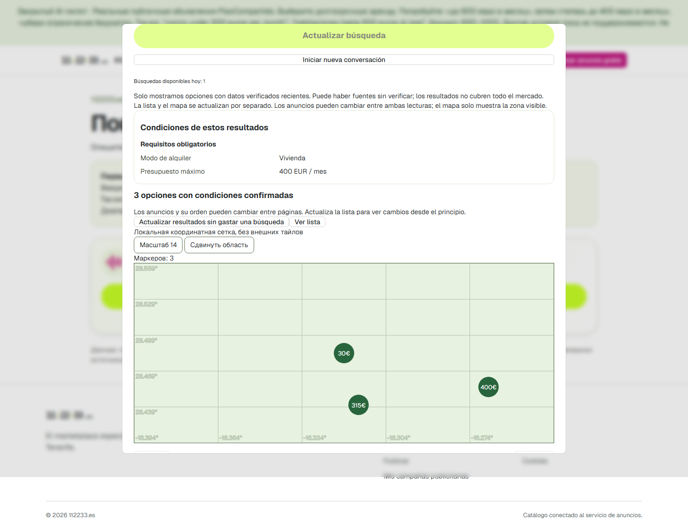

# S2.1 / S3 / S6 · защищённый pilot на домене сайта

08.11.2026 подготовлена реально доступная HTTPS-страница
`https://app.112233.es/ai-pilot/#/`, закрытая HTTP Basic для страницы/assets/API.
Это не прежний localhost tunnel и не synthetic каталог. **Владелец08.11 явно
подтвердил50новыхattempts/$1 в предложенном owner/team nonpersonal rental scope.
Модель включена, реальный HTTPS UI→DeepSeek→SQL→уточнение→карта→reload пройден.
Пилот оставлен активным:4/50attempts,46осталось; local reserve44240microUSD.**

## Реальный допущенный показ · 08.11,16:58–17:03MSK

Первая проверка: budget600→12cards икарта. Затем test-script остановился после
успешного запроса, потому что искал старую подпись textarea: после результата
existing UI меняет её на «¿Qué quieres cambiar?». Это ошибка локатора скрипта,
не failure модели/сервера. Receipt/первыйdispatch сохранены, budget не сбрасывался.
В новом guest test session с тем же global journal выполнена полная цепочка:
**600→12,400→3,remove budget→13**, quota2→1→0. Итого4успешных model calls,
а не3; все4usage подтверждены. Новые вызовы внутри scope50, без refund/reset.
Второй scripted run сохранял private browser cookie state после каждого receipt.

Настоящие cards и карта отрисованы в1440px. Reload восстановил13карточек
без нового dispatch (до/после4). Дополнительно390px: тот же owned result
rehydrated по locator с cookie той же тестовой сессии,13cards/map PASS,
дополнительных model calls0. Это не создание новой сессии от чужого identity.
Неподдерживаемый неперсональный запрос с pet condition отвергнут локально:
INTENT_UNSUPPORTED, sessionversion0, quota3, provider attempts остались4.

Стоимость: reserved44240microUSD ($0.044240),14715prompt/132completion tokens;
observed peak estimate4573microUSD ($0.004573), не invoice. Budget journal тот
же новый pilot, historical synthetic/sealed3/3 не изменялись. Перед активацией
сохранены DB dump/state backup, approval/key установлены через SSH stdin,
key mode400/owner999, только backend readonly control mount. Provider-only
proxy/network и browser CSP сохранены. Ключ/approval оставлены для разрешённого
ручного теста, а не сняты после этих4calls. Глобальный лимит50 иper-guest3/день
Europe/Madrid независимы; собственный новый browser гостя получает обычные3.

После проверки сохранён согласованный SQLite backup текущего provider journal4/
44240microUSD и отдельный dump pilot DB в root-private `audit-20261108-after-live`;
[hash checkpoint](ai-site-pilot-20261108-evidence/live-checkpoint.json).
Это checkpoint текущего счётчика, не разрешение восстанавливать старую копию
ради нового расхода и не полный production restore certification.

Live evidence:
[UI receipts/reload](ai-site-pilot-20261108-evidence/live-ui-proof.json),
[mobile restoration](ai-site-pilot-20261108-evidence/live-mobile-proof.json),
[negative input](ai-site-pilot-20261108-evidence/live-negative-proof.json),
[budget/SQL receipts](ai-site-pilot-20261108-evidence/live-receipt.json).

Ветка `codex/ai-search-site-pilot`, application source `54d3a28d149e15c3d252db1ba05d4e710532769d`, [draft PR411](https://github.com/antony502189-max/Ttest/pull/411), продолжает merged main345b7ca8. Прежние
review409/410 не повторялись. Owned final docs сохранены отдельным commit перед
созданием ветки, чужие dirty changes старого root checkout не менялись.

## Подготовка до нового допуска · исторический срез3.14

- DNS `app.112233.es` →169.58.147.65, existing Traefik/HTTPS. Только route
  `Host(app.112233.es) && PathPrefix(/ai-pilot)`, отдельный frontend8443.
- Unauthenticated401; authenticated desktop1440 и mobile390 страницы открыты,
  JS errors/HTTP5xx0. UI показывает pending approval, submit заблокирован.
- Гостевая identity/session, secure/HttpOnly/SameSite cookie с отдельным
  `/ai-pilot/api/v1/ai-search` path, verified SQL cards13/13 и map1cluster
  через настоящий HTTPS API. Quota remaining3, model calls0. Test session закрыта.
- Отдельная DB0079, Redis и maintenance; source snapshot13unique/public
  PisoCompartido от08.11 16:27:23MSK,13query proofs. Нет account/contact/raw/description
  export, crawling или копирования основной DB. Snapshot стареет по исходным
  timestamps, standing refresh не заявлен.
- Backend только internal network; direct TCP egress blocked. Отдельный CONNECT
  proxy отверг example.com, разрешил TLS GET api.deepseek.com401 без generation.
  Ключ не загружен, approval artifact отсутствует, journal attempts0/reserve0.
- Pipeline/currentness/typed matching/quota/receipt остаются существующими.
  Positive grammar реконструирует только English rent command + число50–1000;
  исходный input/identity/listings не пересылаются. Unknown input отвергается
  целиком. Это scoped nonpersonal test gate, не public privacy certification.

## Исправления, найденные на реальном пути

Первый14-row export имел13unique listings: две активные source записи одной
карточки. Исправлен join через детерминированный LATERAL latest-success/id,
следующий snapshot13создан отдельно; failed export сохранён, не импортирован.

ORM defaults превращали явные source NULL в furnished=true/room_capacity=1 и
подобные значения. Seeder теперь вставляет SQL NULL явно. До ремонта отдельной
pilot DB сохранены dump/state backup;103nullable fields приведены строго к
bound immutable snapshot, snapshots/keys/journals не сбрасывались. Проверка
`verify_catalog` затем прошла, seeder resumed до13proofs/completed. Добавлен
disposable PG regression с repeated seed и неизменными state bytes.

Первоначальный новый erasure env имел hex encoding, а runtime требует base64
32bytes. До создания erasure journal преобразована кодировка тех же bytes,
не заменён секрет. Ошибка остановила seed, повторный запуск продолжил его.

После пересоздания backend nginx держал прежний DNS IP; добавлены Docker
resolver/variable upstream. Mobile onboarding обычного сайта скрывал pilot page;
только pilot build выключает этот shell и использует responsive existing AI
dialog. Homepage выделена под проверку AI, все112233 browser storage/event namespaces вpilot build отдельные, включая favorites/drafts/language/continuation. Новый sentinel test и actual HTTPS desktop/mobile подтвердили сохранность ordinary-site localStorage.

## Проверки и пределы

Финальные локальные62targeted backend PASS; новый disposable PostGIS seed test1PASS
за15.41s; dedicated site-pilot browser8PASS (390/1440 × pending/approved/unavailable/
malformed status), actual HTTPS desktop/mobile/API PASS. Approved-state browser
case имеет intercepted API и не считается реальным model acceptance. Ruff,
oxlint (6pre-existing warnings), i18n guard и tsc-b PASS, pilot Vite build и5case build-mode matrix PASS,990runtime input provenance PASS
(existing chunk-size warning). Новый точный CI ещё не подтверждён.

Предыдущий pre-storage-fix headb2a51e75:9workflows SUCCESS,2conditional SKIPPED,
Mobile/Production ещё in_progress при последней сверке, failure0. В том числе
AI frontend/combined и private seed20/20 PASS (98.72s). Это не CI текущего54d3a28d;
его новый exact-head run нужен после push. Ожидание нового spending approval
этим не отменяется. Скрипты финальной активации/real UI smoke подготовлены в
ignored `output/ai-site-pilot-20261108/activate.py` и `live-smoke.mjs`; не запущены.

Raw proof/screenshot/XML/hash attestation:
[evidence](ai-site-pilot-20261108-evidence/https-ui-proof.json),
[API](ai-site-pilot-20261108-evidence/https-api-proof.json),
[network](ai-site-pilot-20261108-evidence/network-proof.json),
[PostGIS](ai-site-pilot-20261108-evidence/pilot-null-pg.xml).
Секреты и snapshot в evidence/Git не входят. Access credentials только в локальном
ignored `output/ai-site-pilot-20261108/private/access.txt`.

VPS `/srv/112233-ai-site-pilot-20261108`, Compose
`ttest-ai-site-pilot-20261108`. [Configuration/rollback](../../deploy/ai-site-pilot/README.md).
Основной frontend1292c680/production DB0066 и sealed demo3/3 не менялись. Существующий
runtime backend сверяется SHA256 с локальными файлами отдельно от Git/CI.

Шаг активации после owner approval выполнен, новые инструкции доступа и результаты
сохранены. Далее — ручная проверка владельцем/командой в оставшихся46attempts,
обработка конкретной обратной связи и продолжение S2.1 standing freshness/quality
на существующем pipeline. Snapshot expiry не обходить правкой timestamps.
Public real-user rollout, полные S2/S3/S6,
account/data/performance/release и voice/saved/delivery/A1–A12 остаются открытыми.
