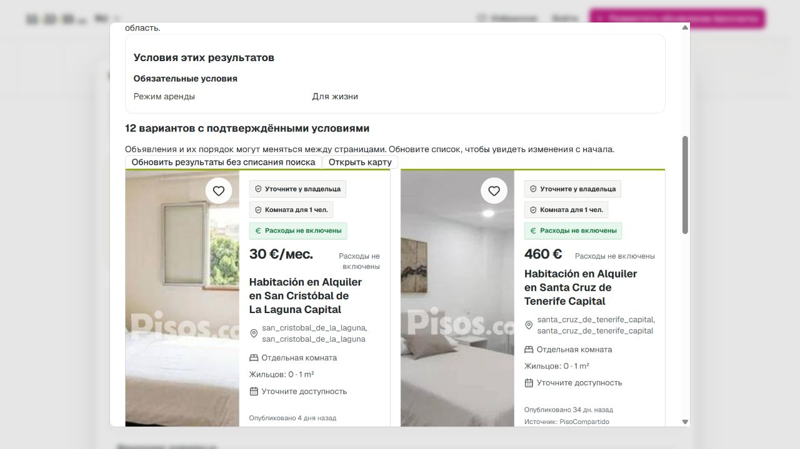
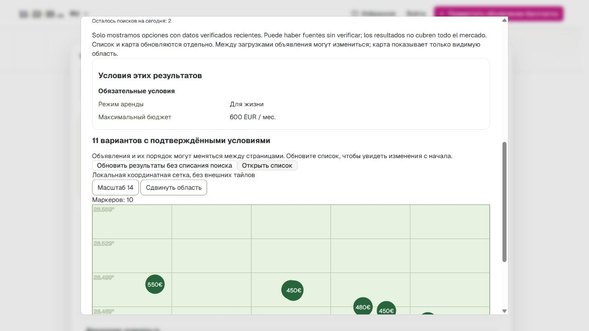

# S2.1 / S3 / S6 — настоящий закрытый текстовый показ, 08.11.2026

**UI→DeepSeek→PostgreSQL→реальные карточки/карта прошёл 3/3.**
Application source `baf8f5ae4f0cb0d92d84257097abb25c6d8102c7`, [draft PR410](https://github.com/antony502189-max/Ttest/pull/410).
Владелец явно разрешил три показанные фразы и дополнительный предел $0.10.
Это закрытая демонстрация на снимке реальных публичных данных, не synthetic
corpus и не public production release. Первоначальный вопрос был непонятен
владельцу; после простого конкретного объяснения получено явное «Да, разрешаю
такой закрытый показ». Повторного общего согласования не запрашивалось.

| Действие в настоящем браузере | Принятый intent | SQL result count |
| --- | --- | ---: |
| «до 600 евро в месяц» | long + hard budget600EUR/monthly | 11 |
| «теперь до 400 евро в месяц» | long + hard budget400EUR/monthly | 3 |
| «убери ограничение бюджета» | long, только пользовательский budget удалён | 12 |

Прежний public long-term cap1000EUR сохранён. Карта прочитана из verified SQL API:
10 маркеров в выбранном viewport при первом запросе,3 при400EUR,11 при финальных
12 карточках. Viewport не охватывает весь каталог. Это координатная сетка без
внешних тайлов; fixture markers и mock model transport отсутствуют.

## Доступный результат

Оставлена открытая deliverable вкладка **http://localhost:9444/#/** в in-app browser.
На компьютере владельца работает SSH tunnel9444→VPS loopback19444.
Это локальный адрес для закрытого показа, не ссылка для внешнего заказчика.
Существующую вкладку/скриншоты можно показать заказчику. Новая вкладка открывает
landing, а не автоматически чужую owned session.

VPS directory `/srv/112233-ai-private-demo-20261108`, отдельный Compose project
`ttest-ai-text-demo-20261108`. Только отдельная demo DB мигрирована0066→0079.
Production current и public build-info остались
`1292c6807ece59999238bb31c80e09ef7e2c3212`, production DB0066 не изменялась.
Private backend подключён к отдельным PostgreSQL/PostGIS и Redis, maintenance
supervisor работает. Порт demo опубликован только на127.0.0.1 VPS. HTTP только
на loopback, межмашинное соединение зашифровано SSH; browser/security exceptions
и изменения Windows certificate store не использовались.

## Настоящие данные и точная граница доказательства

Read-only production inventory по existing `visible_query()`:
1439public cards/132source-healthy≤24h. Это не AI proof coverage всего сайта.
Для разрешённого показа экспортирован минимальный public PisoCompartido subset:
**12 записей**, snapshot **08.11 01:51:11MSK**. Аккаунты, контакты, raw payload
и описания не копировались; technical owner связывает FK в изолированной БД.
Из исходного каталога сохранены публичные title/цены/карточные поля/фото/ссылки,
approximate coordinates и исходные source check timestamps. Нового crawling,
backfill, ручного продления freshness или отправки объявлений модели не было.

`ai_pisocompartido_price` допускает только price/rental_mode: число в source price
text должно совпасть с import amount/EUR/period/month и mode/long; starting price,
валюта/период/сумма с расхождением отвергаются. Cadence берётся из existing
import.price_period, а не нового чтения внешней страницы. Прочие legacy booleans
не становятся AI facts. **12 реальных SQL proofs** подготовлены существующими
observe→claim→complete→QueryProofs. Поиск использует прежние currentness/source
health/proof-age guards и owned session/quota, не новый упрощённый SQL обход.

Snapshot статичен, текущие часы продолжают влиять на eligibility. Этот показ не
доказывает постоянное обновление, точность всего импортера, полное покрытие полей,
доступность бронирования или всю Испанию. Видимые legacy данные1m² и отдельные
испанские строки требуют дальнейшей продуктовой/data проверки; не исправлялись
выдумыванием значений. Исправлен обнаруженный NaN возраста карточек: копируются
настоящие public publication/creation timestamps, proofs перепроверены без LLM.

Первый seed дошёл до SQL constraint failure из-за неhex fingerprint новой копии;
в изолированной DB сохранены12 записей, fingerprint исправлен на digest, затем
реальные proofs подготовлены. Сброса DB/provider journal и повторных paid calls
для этого не было. Seeder исправлен для следующего разрешённого нового стенда.

## Модель, расходы и cleanup

Использован настоящий `https://api.deepseek.com/chat/completions`, requested model
`deepseek-flash`, non-thinking, max_tokens1024, один attempt на операцию, parser10s
в execution15s/HTTP20s. Account balance endpoint200/is_available=true проверен
без generation call. Все три generation responses200, usage подтверждён3/3.
Ввод ограничен exact тремя фразами и соответствующим typed состоянием600→400→none;
history, IDs, контакты и объявления в payload не входят.

Отдельный persistent demo journal: **3 attempts**, **33180microUSD ($0.033180)
reserved**,11027prompt/94completion tokens. По peak ставкам observed usage estimate
3421microUSD ($0.003421), это не invoice. Peak cache-miss $0.30/1M input и $1.20/1M
output сверены08.11 по [официальной pricing page](https://api-docs.deepseek.com/quick_start/pricing/).
Резерв ниже согласованного $0.10, cache/off-peak скидки для admission не учитывались.
Прежний synthetic journal52/575120microUSD не открывался и не изменялся.

**После трёх обращений ключ отмонтирован, его временная private server copy удалена,
backend egress отключён.** В памяти перезапущенного backend фиктивная строка
`budget-exhausted-no-live-key`, persistent journal запрещает четвёртый dispatch.
Результаты/карта/страницы продолжают читаться. Новых model calls не разрешено.
Guest quota и demo provider budget различны: во время проверки прошла полночь
Europe/Madrid, UI снова показал3 guest searches; DB сохраняет used3/reserved0 за
07.11, а provider limit остаётся исчерпанным. Это не reset provider allowance.

## Код и проверки

Независимая ветка от `origin/main afdf180c`, без application changes409.
`ai_text_runtime` собирает прежние runtime dependencies вне test-only lab и
публикует capabilities после schema0079, Redis, configured journal binding/replay.
Обычный `app.main` default OFF, public RealUserOutboundDenied не изменён.
Private factory/Compose, exact phrase gate, bounded journal и real price adapter
лежат отдельно; [операции и ограничения](../../deploy/ai-text-demo/README.md).
Frontend private mode переиспользует настоящий UI и existing coordinate renderer.

Финально **1775unit PASS/16skip/404deselected**, в том числе23 focused cases.
Ruff, mypy runtime/price adapter, TypeScript и private Vite build PASS.
Actual Linux PG/PostGIS/Redis + HTTP/browser + DeepSeek3/3 проверены на отдельном
стенде, не на production. Runtime files сверены LF-normalized SHA256 с работающим
контейнером. Предварительные1762/1768counts не суммируются с финальными.
Raw агрегаты/receipts/usage/проверки/hash: [evidence](ai-private-demo-20261108-evidence/live-result.json),
[attestation](ai-private-demo-20261108-evidence/runtime-attestation.json).

PR410 draft, merge не выполнялся. Current-head CI фиксируется отдельно, старый
зелёный CI не сертификат новых изменений. S2/S3/S6 partial: ближайший bounded
текстовый показ выполнен, но произвольный текст, полный account/privacy gate,
standing refresh/quality/performance/voice/saved/delivery/release остаются OPEN.
