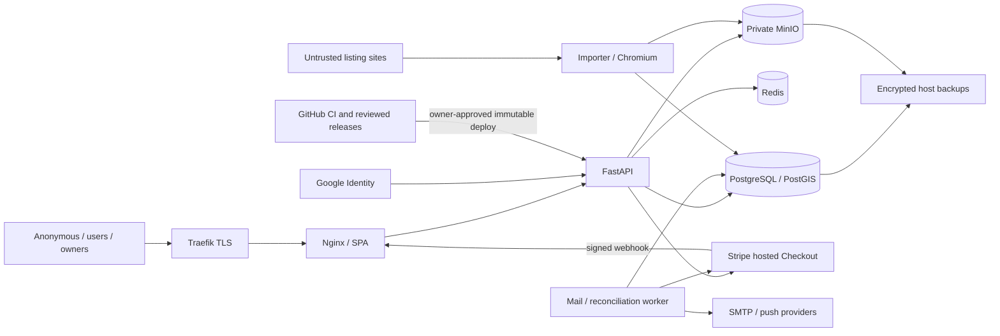

# Threat model

Assets: account control, private contact/location/media, listing ownership,
commercial inventory, order history, credentials, availability and recoverable
user data. Actors: anonymous visitors; users A/B; owners; moderators/admins;
untrusted listing publishers; provider callbacks; CI maintainers; host admins.

## Trust boundaries and abuse cases

| Boundary | STRIDE threats | Controls and verification |
|---|---|---|
| Internet to edge | Spoofed client IP/Host, flooding, disclosure | Nginx sanitizes forwarded hop; exact Traefik hostname; TLS and request limits; provider DDoS controls unverified |
| Browser to identity | Account takeover, token theft/replay, CSRF | Argon2, generic login, throttling, cookie-origin checks, refresh rotation/reuse revocation and session lookup; MFA absent |
| User A to user B's resources | Tampering, privilege escalation, disclosure | Server owner filters, field allowlists and AdminAccess grants; isolated ownership/deletion tests |
| Payment client to order | Price tampering, free entitlement, duplicate reservation | Server prices, durable order UUID/idempotency key, transaction capacity lock; production test Checkout now explicitly gated |
| Stripe event to financial state | Spoofing/replay, stale snapshots, repudiation | Raw HMAC, five-minute tolerance, bound session/amount/currency/environment, locked fulfillment; unique financial inbox and provider GET snapshots |
| Uploaded bytes to native decoder | SSRF, file inclusion, CPU/memory exhaustion | Byte/concurrency/duration limits; image re-encoding; file-only protocol and container-format allowlists for FFmpeg |
| Untrusted sites to importer | SSRF/rebinding, malicious HTML/media, resource exhaustion | HTTP connect-time public-IP pinning, bounded responses/redirect checks; Chromium DNS/egress gap remains SEC-013 |
| App/worker to data network | Disclosure/tampering after app compromise | Network isolation; app DB superuser amplifies compromise (SEC-001); all-purpose MinIO readwrite policy remains broad |
| Edge container to Docker API | Host privilege escalation | Read-only socket mount does not restrict Docker API verbs; socket proxy/redesign requires owner-approved host plan |
| CI to releases | Supply-chain tampering, secret/artifact exposure | Action/image pins and least token rights; no automatic security deployment; absent required human review remains a governance gap |
| Host to recovery media | Ransomware/data loss | Independent backup HMAC/encryption, locks and freshness gates; same-host keys/backups do not protect against total host compromise |

Highest priorities are SSRF containment, least-privilege database credentials,
reviewed payment activation and verified off-host recovery. No evidence of
active compromise was established; no invasive production exploitation was
attempted. Browser egress risk and undiscovered credentials are investigation
items, not confirmed exploitation.
