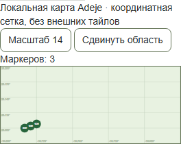
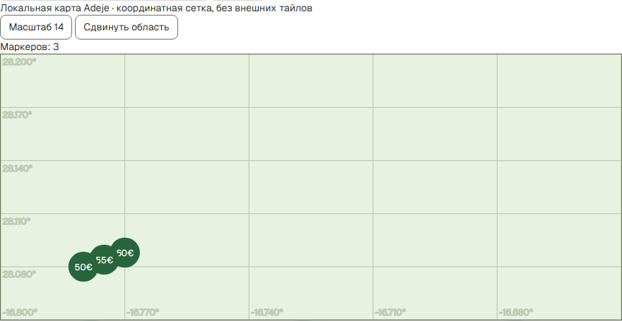

# Пункт 2 — функциональная приёмка закрытого AI стенда

31 октября 2026, Europe/Moscow. **Пункт 2 выполнен: 29 сценариев PASS.**
Это приёмка текстового synthetic контура; пункты 3–8 и public release не приняты.

Runtime/UI/API source: `70330a138cdb1a8313fc0ed61bc69b7ecbfc4985`.
Финальный test driver: `59ee317b9c4c77ca8fe0e1b985bf0f2a947ac494`
(только усиление проверки точных IDs пагинации, runtime файлы не менялись).
URL при проверке: https://localhost:9443. Ветка `codex/post-merge-remediation`,
тот же draft PR #403, без merge. Исходный Documents checkout не менялся.

[Воспроизводимая автоматическая и ручная матрица](../docs/ai-search-developer/AI_TEXT_ACCEPTANCE_RU.md),
[результат 29 сценариев](ai-text-acceptance-evidence/acceptance.json),
[журнал](ai-text-acceptance-evidence/acceptance.log),
[source/file hashes](ai-text-acceptance-evidence/source-attestation.json).
Внутри backend все **160 Python files**, а в frontend все **117 файлов snapshot**
побайтно совпали с принятым source/build; driver/control hashes записаны отдельно.

## Найденные и исправленные дефекты

- Reload терял диалог. Теперь sessionStorage содержит только session/result UUID,
  раздельно для guest/auth. Backend заново проверяет ownership/expiry, UI читает
  текущую editable session и исходный committed result раздельно. Нет prompt,
  criteria, cards, tokens или pending text в browser storage.
- Временный отказ восстановления теперь сохраняет locators и позволяет явный
  retry. Неверные/чужие/истёкшие ссылки не восстанавливают карточки и не создают
  новую сессию автоматически.
- При недействительном результате старые карточки и карта скрываются;
  неподтверждённые карточки не остаются показанными после invalidation.
  Текущий диалог и текст сохраняются для следующего явного запроса.
- На 320 px реальные карточки расширяли grid диалога горизонтально.
  Grid ограничен minmax(0,1fr), controls переносят текст.
- Добавлено «Прекратить ожидание». Это client abort с сохранением exact retry,
  без обещания rollback принятой сервером операции. Backend task cancellation
  до finalize проверена отдельно: reservation released, debit=0.

Публичный HTTP API и default-disabled activation не расширялись. Test controls
доступны только через local CLI с purpose label и dedicated DB marker.
Синтетические model-boundary delay/failure/cancel и call counters не подменяют
backend API; в браузере нет fabricated API responses. В loss-сценариях настоящий
`route.fetch()` завершается на сервере, затем `route.abort()` теряет доставку.

## Пройденные проверки

- **9 UI комбинаций:** ES/EN/RU × 320/768/1440 px. Реальные ввод → typed intent →
  SQL → 7 карточек (6+1), exact union IDs и назад те же 6, уточнение pets → 5,
  reload → тот же owned result, nightly budget → 3, те же 3 маркера. Mobile
  onboarding после reload пройден настоящими UI шагами. Quota=3 used/0 reserved.
- Hard/soft/deny/unknown/intersections: 7 → soft balcony 7 → hard balcony 4 →
  hard pets 3 → budget40/night 0. Unknown не считается разрешением.
- Source/moderation/price/hidden меняются **между страницами** только у нового
  fixture g. Live card count/map становятся 6, g отсутствует; invalid cursor
  требует requery. Изменённая цена не может получить новый proof со старыми facts.
- Старый committed result сохраняет свои 7 IDs/criteria, новая editable session
  с pets имеет 5. Expired session/result не получают paging/read доступа.
- Реальный browser login и refresh-cookie hydration: auth result переживает reload,
  limit=200/day, quota не меняется от восстановления, guest/auth ownership разделён.
- Реальный mobile zero result, потеря ответа при восстановлении, чужие UUID
  в storage, отсутствие proof и скрытие старой выдачи, expiry через reload.
- Concurrent duplicate, terminal replay, изменённый payload с тем же key,
  новая operation со старой version: один parser call/успех/debit, конфликты
  не вызывают лишнюю inference и не списывают quota.
- Потеря query/create/reset acknowledgement после настоящего commit: точный
  body/key повторяется; result/session совпадают, нет stranded replacement.
- Parser failure и cancellation: used=0/reserved=0. Client abort при delay:
  server success списывает один раз, UI проверяет тот же key и получает terminal;
  повтор не вызывает parser. Call counts проверены в отдельном Redis наблюдателе.
- External browser requests `[]`, page errors `[]`. Технические budgets не менялись;
  runner умеет уважать Retry-After вместо обхода limiter.

Дополнительно: [13 baseline smoke PASS](ai-text-acceptance-evidence/baseline-smoke.json),
[50 прежних browser contracts PASS](ai-text-acceptance-evidence/existing-browser.log),
[5 composition guards PASS](ai-text-acceptance-evidence/unit.log),
[Ruff PASS](ai-text-acceptance-evidence/ruff.log), TypeScript/oxlint/i18n guard PASS,
pip check PASS. [Isolation/Redis failure/recovery PASS](ai-text-acceptance-evidence/isolation.json).
Обычный long search и smoke 4/2/1 сохранились на прежнем API пути.
На exact runtime source все **11 исполнявшихся CI workflows PASS**, два conditional
visual workflow skipped: [CI snapshot](ai-text-acceptance-evidence/ci-runtime.json).
Включены Full/Production/Mobile audits, AI facts/quota/frontend, security и
существующие остальные checks. Это не certification capacity или public release.

## Данные и границы результата

Добавлены только 7 holiday fixtures, отдельные synthetic host/auth account;
исходные 7 long fixtures не менялись. Итог: **14 listings, 14 batches,
45 facts, 14 projections, 14 proofs**, pending operations=0:
[SQL counts](ai-text-acceptance-evidence/catalog.log).
В конце runner восстанавливает свои fixtures и истекает только собранные test
sessions; receipts/quota не удаляются. Raw evidence этапа 1 и capacity не менялись.

Карта остаётся локальной координатной сеткой без внешних тайлов. Parser — конечный
набор точных фраз, extraction синтетическая. UI языки не являются оценкой качества
многоязычной модели. Текст pending operation не хранится после reload и не
отправляется повторно автоматически. Privacy/retention/product policies — пункт 6.

ISSUE-004 остаётся OPEN / capacity BLOCKED. Больших нагрузок, реальных providers,
ASR/crawl/backfill, application/production DB, платежей, уведомлений, Pages и
внешнего deploy не было. PR остаётся draft/no merge.

По отдельной просьбе пользователя перед выключением ноутбука собственные четыре
контейнера стенда остановлены; volumes сохранены. После включения использовать
`./scripts/ai-text-lab.ps1 start`. Отчёт, code и evidence опубликованы в том же PR.
[Stop log](ai-text-acceptance-evidence/stop.log),
[финальные состояния](ai-text-acceptance-evidence/stopped-state.log).
