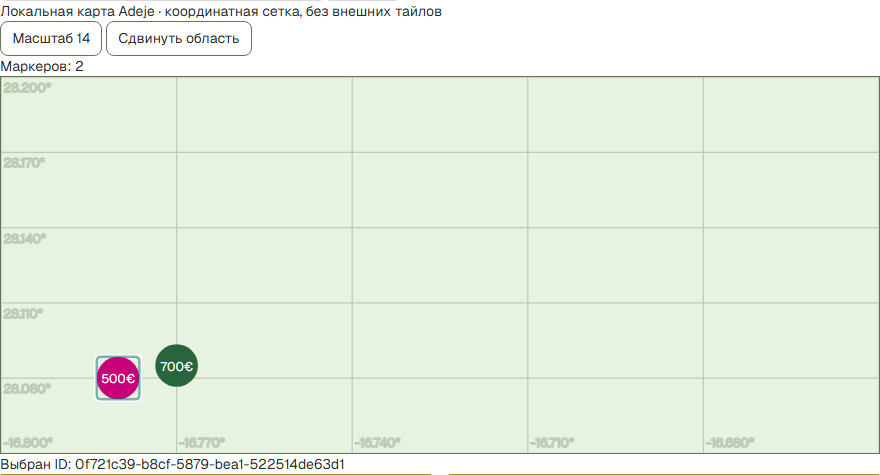
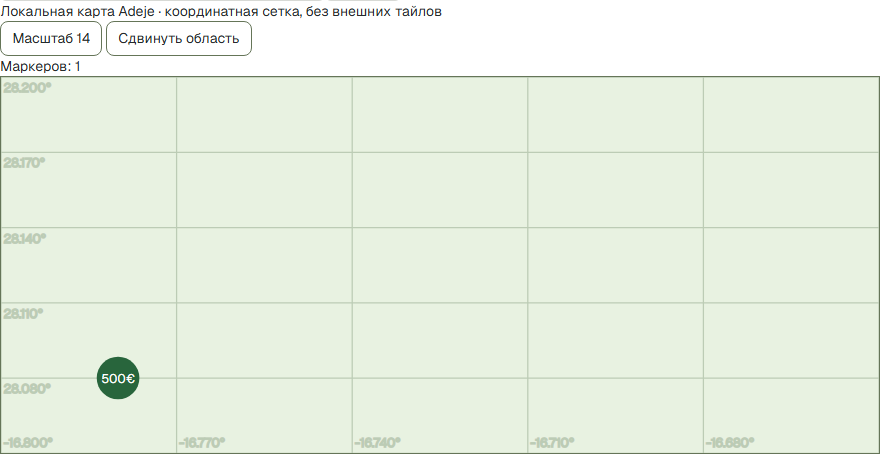
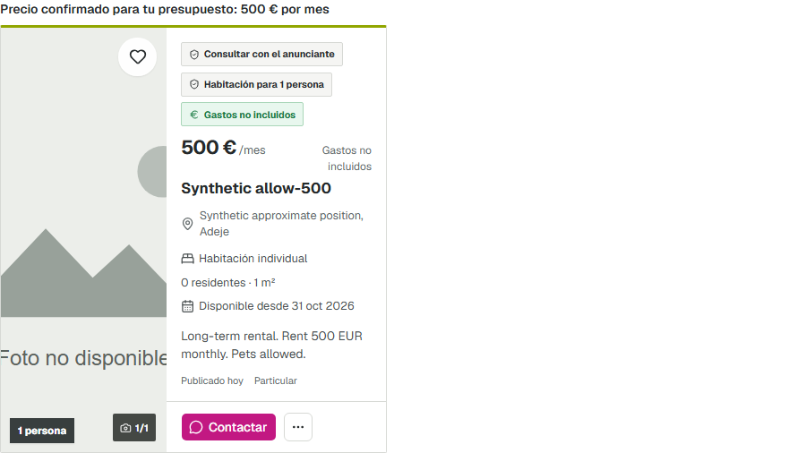

# Закрытый функциональный текстовый стенд — пункт 1

31 октября 2026, Europe/Moscow. **Пункт 1 выполнен; функциональный smoke PASS.**
Пункты 2–8 этим не принимаются. ISSUE-004 OPEN, capacity acceptance BLOCKED;
новой нагрузки и переноса synthetic lab SLO на этот стенд не было.

## Source, адрес, запуск

- Проверенный source: `e398287a241d4fb3aef1c3f15a0a14475b0ab821`.
- Worktree: `C:\Users\HONOR\.codex\worktrees\main-integration-audit\Ttest`,
  ветка `codex/post-merge-remediation`, существующий draft PR #403, **не мержить**.
  Плановый commit `c9268aad` сохранён в истории. Исходный Documents checkout не менялся.
- UI/API: **https://localhost:9443**, только `127.0.0.1:9443` опубликован на host.
  Стенд оставлен запущенным. `start/seed/status/stop` проверены, инструкция:
  [AI_TEXT_LAB_RU.md](../docs/ai-search-developer/AI_TEXT_LAB_RU.md).
- Source берётся из `git archive HEAD`; `/build-info.json`, labels и source.json
  проверяются smoke. Все **159 Python files** внутри backend побайтно совпали
  с архивом: [source attestation](ai-text-lab-evidence/source-attestation.json).
  SHA256 архива и hashes файлов, Node v24.22.1, Vite 8.3.5, TypeScript 6.0.3,
  Playwright 1.61.1 сохранены там же; installed versions совпали с package-lock.
  Dependency images и фактические runtime image IDs:
  [isolation attestation](ai-text-lab-evidence/isolation.json).

## Что собрано

Явный test-only composition root `lab.ai_text:create_app`: AISearchRuntime,
QuotaLedger, SearchSessions, FactPipeline, VerifiedCardSearch, TextSearchExecution,
independent guest/cursor signing, fail-closed Redis HTTP/attempt gates и bounded
HTTP/session/lease policies. Production `app.main:app` runtime не создаёт, даже
при lab env; это проверено отдельным тестом. Старый OfflineDeepSeekIntent и его
ограничение MockTransport не менялись. Обычный поиск остаётся на прежнем пути.

Синтетический каталог проходит настоящий `observe → claim → complete →
facts/projections → QueryProofs.prepare`: **7 succeeded jobs, 7 batches, 20 facts,
7 projections, 7 proofs**, migration `0075_ai_proof_population`.
[SQL counts](ai-text-lab-evidence/catalog.log), [status](ai-text-lab-evidence/status.log).
Нет прямого fixture API, вставки готовых proof rows или browser route mocks.

`SyntheticParser` — конечный список документированных фраз, **не настоящая модель**.
Extraction — синтетические typed facts с проверяемыми evidence spans.
Неизвестная фраза возвращает failed operation без списания. Реальные providers,
ASR, crawl/backfill и workers не включены, production/application DB не используются.

HTTPS reverse proxy сохраняет Host и same-origin; настоящая guest cookie имеет
Secure/HttpOnly/SameSite=Strict. Origin/CSRF/ownership не ослаблены. Для test
Chromium допускается только локальный self-signed TLS certificate; доверие ОС
не менялось. Ручному браузеру нужен доверенный локальный сертификат — инструкция
объясняет экспорт. Это не production PKI.

AI-карта в этом build — локальная координатная сетка Adeje без provider tiles.
Она читает настоящий verified map endpoint, отображает price/IDs и повторяет
SQL viewport query при pan/zoom. Она не является проверкой Google Maps или
географического покрытия реального каталога. В обычном production build lab
notice, lab map и parser отсутствуют.

## Проверки

[Реальный Chromium smoke](ai-text-lab-evidence/browser-smoke.json): **13 PASS**,
в том числе повтор после полного stop/start:

- Ввод «все варианты» → typed rental_mode → настоящий SQL → четыре известных ID.
- «с маленькой собакой» → hard pets → два ID/два маркера; выбор маркера,
  zoom/pan и нулевая viewport-выдача проверены.
- «до 600 евро в месяц» сохраняет pets, добавляет hard monthly budget → один
  ID `0f721c39-b8cf-5879-bea1-522514de63d1`, подтверждённая цена 500 EUR/monthly,
  один маркер. Typed conditions прочитаны из committed result.
- Explicit deny и unknown pets не подходят hard pets. Source-changed,
  hidden и price-changed после prepare исключаются **до count/page/map**.
- Guest 3/day, исчерпание 429, replay без нового debit, cards/result/session/map
  reads, signed cursor paging и отказ forged cursor.
- Реальный auth login, own session, auth limit 200/day; чужие guest/auth
  session/result reads отклоняются. Несовместимый budget и unknown hard balcony
  дают 0. Origin/CSRF атаки дают 403.
- Обычный `/listings/search/cards` возвращает 6 видимых объявлений через прежний
  API: намеренно отличный от verified AI population путь. External browser
  requests `[]`, page errors `[]`.

Дополнительно:

- [Isolation](ai-text-lab-evidence/isolation.json): только собственные сети,
  containers и volumes; backend не имеет default route. Независимые экземпляры
  AIAttemptGate используют один Redis budget. Реальный stop собственного Redis
  → HTTP 503 `ABUSE_GATE_UNAVAILABLE`, no-store; Redis восстановлен → успех
  без business debit. Никакого memory fallback для AI.
- [5 unit guards PASS](ai-text-lab-evidence/unit.log): marker/key не включают
  runtime, application destinations/production/provider credentials запрещены,
  unknown phrase не расширяет поиск, follow-up сохраняет hard criteria.
- [Ruff PASS](ai-text-lab-evidence/ruff.log), TypeScript PASS, normal/lab build
  PASS, production bundle security PASS, normal bundle не содержит lab UI.
  Oxlint/i18n guard PASS; шесть существующих warnings вне этого изменения.
  Vite сообщает существующий warning о chunk >500 KiB; он не скрыт.
- [50 existing browser contracts PASS](ai-text-lab-evidence/existing-browser-contracts.log),
  включая обычный Google Maps test SDK путь. Эти отдельные mocked contracts
  не подменяют настоящий browser smoke стенда.
- [Повторный seed — проверенный no-op](ai-text-lab-evidence/reseed.log),
  [stop](ai-text-lab-evidence/stop.log), [все четыре остановлены](ai-text-lab-evidence/stopped-state.log),
  [повторный start до ready](ai-text-lab-evidence/restart.log). Launcher не очищал
  volumes. Неполный/неожиданный seed вызывает отказ перезаписи.

## Собственные ресурсы и ограничения

Контейнеры: `ttest-ai-text-lab-{postgres,redis,backend,frontend}`.
Active volumes: `ttest-ai-text-lab-pg-v2`, `ttest-ai-text-lab-{redis,tls,media}-v1`.
Сети: `ttest-ai-text-lab-network` (internal) и `ttest-ai-text-lab-loopback`
(только frontend). Purpose label: `es.ttest.purpose=ai-text-synthetic-lab-v1`.
Backend/DB/Redis ports не публикуются; доступ браузера — через loopback TLS.
Preflight отказывается управлять ресурсом с чужим label, stop не использует
prune/down/remove-orphans. Auth smoke повторно использует свою owned session
и учитывает уже потраченную квоту, не обнуляя её.

При первой сборке обнаружены несовместимый APP_ENV, особенности Docker Desktop
internal-port publishing, права пустого media volume и отсутствие rental_mode
fact. Они исправлены до принятого source. Prototype volume
`ttest-ai-text-lab-pg-v1` оставлен **неподключённым**; accepted seed использует
новый собственный pg-v2. Compose сообщает об этом retained volume, не меняя его.
Старые capacity/audit DB и raw immutable evidence не переиспользовались и не менялись.

Полная матрица пункта 2, качество реальной модели, свежесть реальных источников,
capacity, privacy/product policies и выпуск остаются дальнейшими этапами.
Public AI, реальные LLM/data providers/ASR, платежи, уведомления, Pages и внешний
deploy не активировались. Merge PR #403 не выполнялся.
