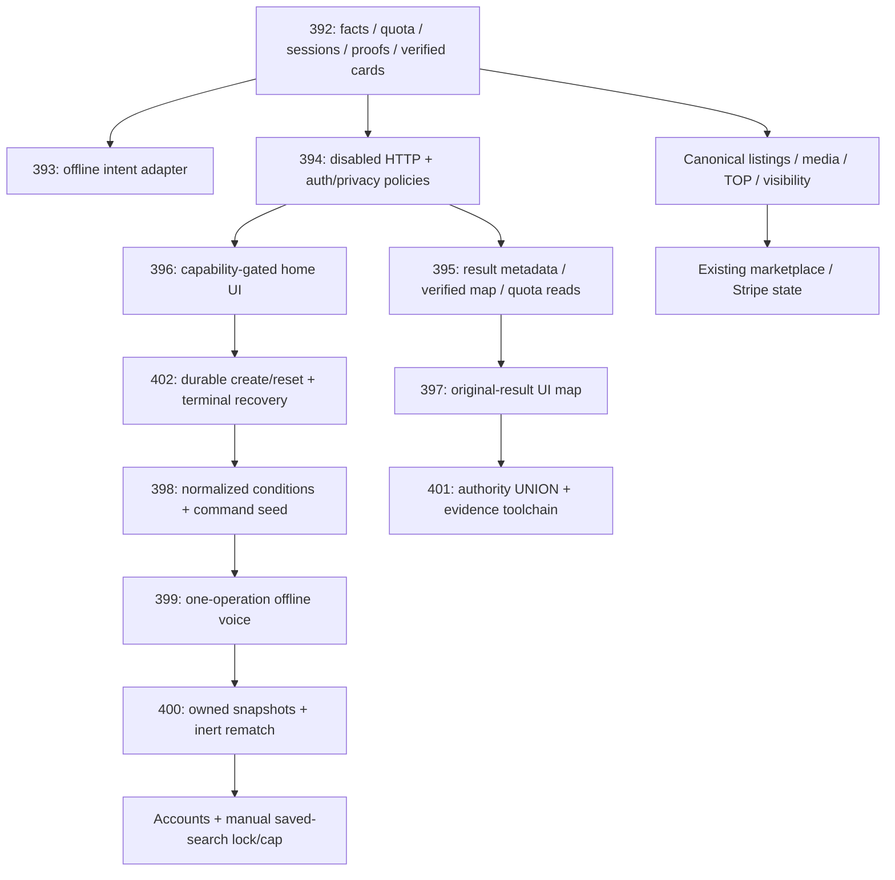

# Полный post-merge интеграционный аудит main

## 1. Резюме

**Дата:** 30 октября 2026, Europe/Moscow. **Репозиторий:** [antony502189-max/Ttest](https://github.com/antony502189-max/Ttest). **Проверенный исходный commit:** `7d4c125574927181511c5f1bc7e201e20a8840a8`. После `git fetch origin` он совпадал с reference SHA из задания; дополнительных merge относительно reference не было. Повторный fetch в конце аудита подтвердил тот же origin/main. Default branch, подтверждённая GitHub API и remote HEAD: `main`.

**Общая оценка: FAIL.** Изолированная AI-основа, миграции и production builds проходят существенный объём проверок. Однако на точном main красный Full audit, подтверждена гонка навигации обычной мобильной карты, а автоматический post-merge контроль AI слабее PR-контроля. **Рекомендация: не объявлять main готовым к staging/production до устранения блокеров и повторной проверки точного нового SHA. Публичную AI-активацию не разрешать.**

Уникальные замечания: **P0 — 0; P1 — 1; P2 — 3; P3 — 1.** P1 относится к воспроизводимо сломанному release/audit gate, а не к доказанной порче production-данных. Ни double debit, ни обход ownership в проверенных AI-путях не подтверждены.

Ключевые результаты:

- Backend unit: **1543 passed, 0 failed, 31 skipped** на Linux/Python 3.13.14. Из этих 31 skips 28 PowerShell-сценариев отдельно исполнены на Windows: **28 passed**. Оставшиеся три — opt-in live/public-source research; они не запускались.
- Backend PostgreSQL/PostGIS: **931 passed, 0 failed, 5 skipped**. MinIO/S3: **1 passed**.
- Настоящий Chromium → frontend → HTTP → PostgreSQL recovery: **4 passed**; отдельный guest-cookie boundary входит в PostgreSQL-прогон.
- AI frontend: **50 passed**; province: **32 passed**; search lifecycle: **62 passed**; production lazy-route preview: **1 passed**; publication: **17 passed**; Google auth: **2 passed**.
- Полный основной Playwright-прогон на Linux: **691 passed, 2 failed, 1 skipped**. Desktop-card timeout прошёл при последовательном повторе. Polygon/navigation failure воспроизведён снова; затем три обычных повтора прошли. Отдельный тест с управляемым порядком camera event стабильно воспроизвёл дефект **2/2**. Первые неуспехи не исключены и не превращены в PASS.
- Реальный full-stack с провайдером, возвращающим отсутствие подтверждённого адреса: **13 passed, 10 failed, 7 skipped**. С уже существующим repository fixture провайдера: **23 passed, 0 failed, 7 skipped**. Application validation не менялась.
- `npm ci`, frontend lint, typecheck, production build, dependency policy и bundle security: **PASS**. Обе production Docker-сборки: **PASS**. Nginx runtime от uid 101 читает и отдаёт shell и legal pages.
- Fresh Alembic chain до `0074_ai_saved_searches`, исторические переходы, сохранение legacy rows, повторный `upgrade head` и отказ downgrade: **PASS** в проверенных сценариях. Независимая проверка имён колонок всех **54 ORM tables** расхождений не нашла; сверена nullable-разметка **15 AI tables**. Existing строгий integration schema-parity gate дополнительно проверил типы/nullability всей application schema. Это не исчерпывающая сертификация всех исторических типов/constraint expressions.

Посчитано **5910 завершённых выполнений test cases без skips**, включая повторы, overlap suites и негативные воспроизведения. Interrupted host runs и GitHub CI не суммировались; число уникальных тестов из этой суммы не выводится. Повторы и пересечения явно отражены в разделе 3 и evidence JSON. Результаты GitHub CI приведены отдельно и не суммируются с локальными запусками.

### Границы и сохранность среды

Исходный checkout `C:/Users/HONOR/Documents/Codex/Ttest` был на устаревшем main и содержал изменённый `deploy/manual-production-runner.sh` и пользовательские untracked artifacts. Он не reset/clean/switch-ился. Работа выполнена в managed worktree `C:/Users/HONOR/.codex/worktrees/main-integration-audit/Ttest`, ветка `codex/main-post-merge-audit`. Application source, migrations, workflow, snapshots и публичные flags не исправлялись.

Для исполнения экспортирован `git archive HEAD`, распакованный в `/audit-src` контейнера. SHA-256 архива: `0ca5a5833f4aeace1e85e470c0f85ae38f5a6928801ace8a5be145356dfd5af4`. Runtime подтвердил импорт `/audit-src/backend/app/__init__.py`. Позднее в snapshot добавлялись только audit test files; application source оставался исходным.

Созданы только собственные `ttest-main-audit-*` контейнеры, отдельный Redis и MinIO, БД `ttest_test`, `ttest_fullstack`, `ai_migration_test_main_audit`. DB host binding — loopback. Existing `ttest-backend-1` на порту 8000 и existing Redis не использовались. Изоляция network namespace позволила выполнить hardcoded full-stack tests на их штатном `127.0.0.1:8000`, не занимая чужой backend. Реальных Stripe keys, customer data, AI providers, ASR, crawls, уведомлений и production deployments не было.

Ограничения: live VPS/staging состояние, административные Pages settings, production resource envelope, retention/privacy approval, реальные provider/media-decoder contracts и новый 100k/500k/1m benchmark не проверялись. Большой benchmark не запускался: существующий stop/authorization boundary сохранён. Указанная в README production VPS не является GitHub Pages и не считается проверенной по результату source-аудита.

## 2. Матрица merge-интеграции

Порядок установлен по first-parent history и сверён с GitHub metadata. Нумерация PR действительно не совпадает с merge order. Полные merge-vs-first-parent patches сохранены в `output/main-integration-audit/pr-NNN.diff`. Прочитаны актуальные PR descriptions, requirements/review-resolution документы и remediation reports. Connector вернул пустые conversation comments и formal review lists для этих 11 PR; эти результаты не означают наличия формального approval. Исторические требования из недоступных исходных чатов не выдумывались.

| PR | Область | Merge SHA / порядок | Интегрирован | Проверено на main | Регрессия / оставшийся gate | Evidence |
|---|---|---|---|---|---|---|
| [392](https://github.com/antony502189-max/Ttest/pull/392) | Facts/parser/quota/session foundation, hard SQL, cards, atomic text | `dd3c8d53`, 1 | Да | Unit, 227 facts-PG, 319 search-PG, full-schema cards | Capacity gate остаётся | PR patch; `test_ai_verified_cards.py`; migration graph |
| [393](https://github.com/antony502189-max/Ttest/pull/393) | Offline DeepSeek intent | `63b6d4a0`, 2 | Да | Strict schema, empty/no-op rejection, deadlines, bytes/retries, PG orchestration | Реальный provider/privacy не активированы | `PR_393_REVIEW_RESOLUTION.md`; adapter unit/PG |
| [394](https://github.com/antony502189-max/Ttest/pull/394) | Disabled HTTP, ownership, CSRF/origin, logging, current card values | `bd24beaa`, 3 | Да | Default-disabled image/HTTP, HTTP negatives, cookie browser | Нет runtime factory для публичного включения | HTTP suites; image smoke |
| [395](https://github.com/antony502189-max/Ttest/pull/395) | Shared verified maps/result metadata/read-only quota | `e50f96a5`, 4 | Да | Real IDs/counts, cluster thresholds, remaps, quota no-write | ISSUE-004 | Full-schema map plans; quota/HTTP tests |
| [396](https://github.com/antony502189-max/Ttest/pull/396) | Private home UI | `883a03c6`, 5 | Да | Capability false, recovery UI, manual filters, desktop/mobile | Новой AI UI blocker не найдено | AI browser 50; real recovery 4 |
| [402](https://github.com/antony502189-max/Ttest/pull/402) | Terminal/session command recovery | `17fe3262`, 6 | Да | Lost ACK, expired cards, create/reset cap, exact keys, cookie bootstrap | Нет доказанного повторного debit | `test_session_commands.py`, browser recovery |
| [397](https://github.com/antony502189-max/Ttest/pull/397) | Original-result AI map | `54df801a`, 7 | Да | Result/hash binding, abort/stale replies, no manual fallback, TOP | ISSUE-002 касается отдельной обычной mobile map | AI browser, `ai-result-map.tsx`, shared map diff |
| [398](https://github.com/antony502189-max/Ttest/pull/398) | 15 normalized conditions, explicit rental mode, 0073 seed | `bb24a18b`, 8 | Да | False/zero/units, source summaries, seed replay, cleanup | Исторические seed-cleanup замечания исправлены | Migration upgrade; session/UI contracts |
| [399](https://github.com/antony502189-max/Ttest/pull/399) | Offline voice/ASR, durable one-debit path | `8484c9c5`, 9 | Да | PG retries/ack/expiry/timeout/CAS, offline adapter negatives | Реальные audio decoding/provider/consent не проверены | `test_voice_execution.py`, ASR tests |
| [400](https://github.com/antony502189-max/Ttest/pull/400) | Registered snapshots/rematch dry runs | `f9212464`, 10 | Да | Ownership, one checkout, shared cap, tombstones, account races, 0074 | Delivery/save HTTP activation отсутствует по дизайну | Saved PG/full-schema/collection browser |
| [401](https://github.com/antony502189-max/Ttest/pull/401) | Indexed authority UNION, capacity evidence toolchain | `7d4c1255`, 11 | Да | Digest parity, mutations, actual EXPLAIN, fake-Docker/PowerShell | ISSUE-004; новый capacity run не проводился | 8 plan summaries; toolchain 28 Windows |

Дополнительно прослежены parent `1292c680` (payment PR #372), текущие account/payment/media/search-state dependencies и geography commit `e7a3e187`. Именно #392 привёз большую объединённую основу (96 files); старые параллельные AI roots не трактовались как отдельно повторно merged PR.

Старый отчёт по #397–400 содержал R-01 stack conflict, R-02 pending expiry, R-03 seeded cleanup, R-04 voice cleanup budget, R-05 nested checkout. На итоговом main соответствующие исправления существуют: unified parents/helper, terminal recovery, seed-aware cleanup, собственный voice deadline и `result_in_transaction` на том же connection. Их регрессии исполнены; старые REQUEST CHANGES не перенесены механически на текущий SHA.

### Карта зависимостей



Это dependencies, а не утверждение, что voice HTTP или saved execution endpoint включены.

## 3. Матрица исполнения тестов

В таблице **P/F/S** означает passed/failed/skipped. Skipped не считаются passed. Deselected означает другой marker/config, а не результат теста. Пересекающиеся suites и retries не суммируются как уникальное покрытие.

### Среды

- Host: Windows/PowerShell, Node **24.22.1**, npm **10.9.9**, Python **3.13.17** для 28 PowerShell tests.
- Linux runner: Python **3.13.14**, pinned `backend/constraints.txt`, Postgres **16.4**, PostGIS **3.4.3**, отдельный Redis 7.4, MinIO. Изображение зависимости initially reused только как OS/runtime; package graph обновлён по constraints и source импортировался из exact archive.
- Production backend Dockerfile: закреплённый Python 3.13 image, новая самостоятельная сборка. Frontend Dockerfile: закреплённый Node **22** build stage.
- Browser JS: Playwright **1.61.1**, Chromium **149.0.7827.55**; Python Playwright **1.62.0** с его отдельно установленным Chromium для HTTP recovery.
- Exact-main CI Full audit: Ubuntu 24.04, Python **3.12.15**, Node **22.23.4**. Это дополнительная runtime-matrix evidence, не локальный Python 3.12 прогон.

| Suite | Точная команда / существенная настройка | Среда | P | F | S | Evidence в `output/main-integration-audit/` |
|---|---|---|---:|---:|---:|---|
| Install/integrity | `pip install --constraint constraints.txt -e '.[dev]'`; `python -m pip check` | Linux 3.13 | — | 0 | — | `backend-install.log`, `pip-check.log` |
| Ruff | `ruff check app tests` | Native Linux archive | — | 0 | — | `ruff.log` |
| Mypy | `mypy app` | Native Linux archive | 153 files | 0 | — | `mypy.log` |
| Backend units, initial environment | `pytest -q -m 'not integration'` | Linux без jq/PowerShell | 1535 | 0 | 39 | `backend-unit-bootstrap.xml` |
| Backend units, final | Та же команда после установки Bash/jq prerequisites | Linux | 1543 | 0 | 31 | `backend-unit.xml` |
| Windows toolchain | `python -m pytest -q backend/tests/test_ai_map_toolchain.py -k 'launcher_provenance or powershell_invalid or monitor_fake or launcher_rejects_db'` | Python 3.13, real PowerShell, fake Docker | 28 | 0 | 0 | `windows-toolchain.xml` |
| PG, initial safety setting | `pytest -q -m 'integration and not s3'`, removal disabled | Linux/PostGIS/Redis | 917 | 14 | 5 | `backend-integration-removal-disabled.xml` |
| PG, final expected test setting | Та же команда, `EXTERNAL_REMOVAL_CHECK_ENABLED=true` | Linux/PostGIS/Redis | 931 | 0 | 5 | `backend-integration.xml` |
| Real browser recovery | `pytest -q tests/integration/test_ai_browser_recovery.py`, `AI_UI_DIST_PATH=/audit-src/dist` | Real HTTP + PG + offline parser | 4 | 0 | 0 | `ai-real-browser-recovery.xml` |
| S3 | `pytest -q -m s3` | Disposable private MinIO bucket | 1 | 0 | 0 | `backend-s3.xml` |
| Fresh migrations | `alembic heads/history/upgrade head/check` | Fresh `ttest_test` | PASS | 0 | — | `alembic-*.log` |
| Historical migrations | `python reports/main-post-merge-audit/reproduce_migrations.py` | New isolated DB | PASS | 0 | — | `historical-migrations-results.json` |
| Dependency audit | `python -m pip_audit -r backend/constraints.txt --no-deps --disable-pip` | Linux; pip-audit 2.10.1 | PASS | 0 | — | `python-dependency-audit.log` |
| Static security | `python -m bandit -r backend/app -ll` | Bandit 1.9.4 | PASS medium/high | 0 medium/high | — | `bandit.log` |
| Supply-chain/migrations | `python scripts/check-supply-chain.py`; `python scripts/check-migration-compatibility.py` | Linux | PASS | 0 | — | `supply-chain.log`, `migration-governance.log` |
| Bounded smoke harness | `python -m unittest -v test_capacity_smoke.py` | Local synthetic safeguard tests | 18 | 0 | 0 | `capacity-safeguards.log` |
| Frontend install | `npm ci` | Windows; также native Linux | PASS | 0 | — | `npm-ci.log`, `npm-ci-linux.log` |
| Frontend static/build | `npm run lint`; `npm run typecheck`; `npm run build` | Windows + Docker Node22 build | PASS | 0 | — | `frontend-*.log` |
| Frontend security | `npm run test:security`; `npm run test:bundle-security` | Production dist, mocks off | PASS | 0 | — | `frontend-security.log`, `frontend-bundle-security.log` |
| AI UI/map/collection | `npx playwright test --config playwright.ai-search.config.ts` | Windows; offline API/Maps fixtures | 50 | 0 | 0 | `browser-ai.log` |
| Province/TOP/location | `npx playwright test --config playwright.province.config.ts` | Windows | 32 | 0 | 0 | `browser-province.log` |
| Search lifecycle | `npx playwright test --config playwright.search-lifecycle.config.ts` | Windows | 62 | 0 | 0 | `browser-lifecycle.log` |
| Production lazy route | `npx playwright test --config playwright.route-critical-preview.config.ts` | Vite production preview | 1 | 0 | 0 | `browser-route.log` |
| Publication | `npx playwright test --config playwright.publication.config.ts` | Windows | 17 | 0 | 0 | `browser-publication.log` |
| Google auth | `npx playwright test --config playwright.google-auth.config.ts` | Offline Google boundary | 2 | 0 | 0 | `browser-google-auth.log` |
| Complete main browser suite | `node node_modules/@playwright/test/cli.js test --workers=4 --reporter=line,junit` | Native Linux, pinned baselines, same default config | 691 | 2 | 1 | `browser-linux-default.xml` |
| Two failures, sequential retry | Те же два теста, `--workers=1` | Linux | 1 | 1 | 0 | `browser-linux-retry.xml` |
| Natural polygon repeats | Existing polygon test, `--repeat-each=3 --workers=1` | Linux | 3 | 0 | 0 | `browser-polygon-repeat.xml` |
| Controlled polygon race | Audit test, delayed camera event after route push, 2 repeats | Linux, unchanged app | 0 | 2 | 0 | `map-transition-forced.log` |
| Full-stack negative control | `node .../cli.js test --config playwright.fullstack.config.ts`, empty address provider | Real frontend/API/DB | 13 | 10 | 7 | `fullstack-empty-provider.log` |
| Full-stack fixture | Та же команда, repository `fullstack_test_app:app` | Real frontend/API/DB | 23 | 0 | 7 | `fullstack-fixture-provider.log` |
| Admin performance contracts | `npx playwright test --config playwright.admin-performance.config.ts` | Windows, ordinary config | 8 | 0 | 16 | `browser-admin-performance.log` |

Полный `npm run test:e2e` сначала не стартовал: существующий shared service занимал host 4173. Он не останавливался. Попытка перенести host runner на 4183 обнаружила hardcoded permission origin 4173 в старых tests; такой частичный прогон остановлен как невалидная среда. Затем весь default suite выполнен в изолированном Linux namespace на штатном 4173. Publication/Google configs выполнены отдельно, даже после failed default suite. Tests не исключались ради зелёного результата.

Первый Ruff на Windows bind mount дал 335 `EXE002`: Docker показывал tracked 100644 files как mode 0777. Повтор на native archive с корректными modes прошёл без изменения правил Ruff. Первый запуск orchestration до окончания установки dev tools также был bootstrap failure, не результат приложения.

Initial PG 14 failures объясняются audit env `EXTERNAL_REMOVAL_CHECK_ENABLED=false`: `external_removal.py` корректно выполняет kill switch, а тесты ожидают fake-probe purge/failover. Исправлена только среда повторного теста; никакой worker/crawl не запускался. Старые failures сохранены.

PG skips: четыре frontend recovery cases без `AI_UI_DIST_PATH` выполнены отдельным прогоном; optional `AI_UI_TEST_URL` ASGI bridge не включён и не считается пройденным. Full-stack skips — условные mobile-only/legacy scenarios; основной browser skip зафиксирован в XML. Admin config имеет 16 opt-in before/after benchmark skips; обычные 8 bounded-loading contracts прошли. Эти 16 benchmark cases не считаются проверенными. Native Linux units имеют 28 Windows-only skips, покрытых отдельными Windows tests, и три намеренно не запущенных live opt-ins.

## 4. Отчёт о БД и миграциях

### Граф и fresh install

Единственный head: `0074_ai_saved_searches`. Линейная цепочка содержит `0001_core` … `0066_complimentary_ads`, далее:

```text
0066_complimentary_ads
 -> 0067_ai_search_quota
 -> 0068_ai_search_sessions
 -> 0069_ai_listing_facts
 -> 0070_ai_fact_pipeline
 -> 0071_ai_query_proofs
 -> 0072_ai_session_commands
 -> 0073_ai_command_seed
 -> 0074_ai_saved_searches
```

Graph/governance tests проверяют единственную полную цепочку и immutable released migrations. Fresh upgrade завершился; фактически созданы quota/session/facts/pipeline/proof/commands/saved tables. Инвентаризация включает columns, indexes, FKs и CHECKs 15 AI tables в `schema-inventory.json`. Реальные constraint/transaction/ownership tests существенно сильнее одного успешного Alembic exit code.

`alembic check` прошёл, но его значение ограничено: в `env.py` intentionally исключены все reflected objects кроме tables. Canary rename `ai_session_commands.seed_mode` → `audit_drift_seed_mode` также прошёл check. Canary немедленно возвращён обратно только в disposable historical DB. Это намеренное ограничение Alembic CLI, **не отдельный дефект**: существующий `backend/tests/integration/test_schema_parity.py` сравнивает tables/columns/types/nullability с узким directional legacy allowlist. Он прошёл в полном PG-прогоне. Дополнительно тот же strict contract на canary действительно вернул `add_column: ai_session_commands.seed_mode` и `remove_column: ai_session_commands.audit_drift_seed_mode`. Canary восстановлен; это важная компенсация ограничения `alembic check`.

### Исторические переходы и данные

Новая отдельная БД поднята до `0066`; вставлены legacy user/manual saved search. После `0071` вставлена auth session; после `0072` — old-style create-command receipt. После `0073` verified `seed_mode IS NULL` для старого receipt. После `0074` проверены:

- неизменность user/email и manual name/query;
- server default `matcher='manual.v1'`;
- сохранение session criteria и command result binding;
- отсутствие лишних/пропавших ORM columns;
- повторный `upgrade head` без изменения данных.

Это один последовательный populated upgrade path через все требуемые intermediate revisions, не исчерпывающая матрица всех production data distributions. Listing/payment/saved/account совместимость дополнительно проверена full-schema integration suites.

### Безопасность DDL и rollback

AI revisions additive. `0073` добавляет nullable seed; `0074` — constant-default manual discriminator и отдельные AI tables/FKs. На PostgreSQL16 constant default не требует прикладного row-by-row backfill, однако ALTER TABLE всё равно нуждается в DDL lock. Нагрузочное измерение блокировок на больших реальных таблицах не выполнялось. Автоматическое утверждение zero-downtime не даётся.

Прямой `alembic downgrade 0073_ai_command_seed` из 0074 в disposable DB отклонён с `SCHEMA_DOWNGRADE_DISABLED`; stamp и rows остались прежними. Правильный rollback — предыдущий совместимый **binary**, сохранение schema/stamp 0074, затем redeploy актуального binary через approved release procedure. Нельзя откатывать stamp, запускать 0074 повторно под искусственно пониженным stamp или удалять AI tables. Старые binaries могут превысить общий AI/manual cap; предусмотренный forward-management сохраняет строки, разрешает list/delete и блокирует новые saves до освобождения slots. Этот сценарий покрыт существующими integration tests.

### Инварианты

Quota day locking/fence, session CAS, result receipt и debit проверены фактическим PostgreSQL state. Saved commands сохраняют null-target tombstone после удаления snapshot. User self-delete сериализуется с save через shared collection lock; проверены оба порядка гонки. Payment/account protection и listing removal покрыты legacy integration tests. Это подтверждение проверенных сценариев, не математическое доказательство отсутствия всех возможных deadlocks.

## 5. Build и CI

### Production builds

Frontend `tsc -b && vite build` завершился, использованы locked Vite 8.3.5 / React19 graph. Есть обычное предупреждение Vite о размере chunks; падения сборки нет. Bundle security не нашёл запрещённых mock/security artifacts. Runtime API default — same-origin `/api/v1`; отдельная AI-recovery mock build создана в контейнере и не заменяла production image.

Обе Dockerfiles собраны из проверенного checkout. Backend image import smoke с `--network none` прошёл и подтвердил отсутствие `ai_search_runtime`. Frontend image содержит точный `build-info.json`, uid101 отдаёт shell, favicon, privacidad и terminos в read-only runtime. Docker warning о названии `VITE_GOOGLE_MAPS_API_KEY` сам по себе не является утечкой server secret: browser Maps key публичен по назначению; production credentials в build не передавались. Проверка корректных referrer restrictions требует реальной configuration evidence и здесь не проводилась.

### Exact-main CI

Public GitHub Actions REST inventory для audited SHA вернул **четыре** runs:

| Workflow | Run | Итог |
|---|---|---|
| Full audit | [40944443303](https://github.com/antony502189-max/Ttest/actions/runs/40944443303) | failure |
| GitHub Pages UI preview | [40944443316](https://github.com/antony502189-max/Ttest/actions/runs/40944443316) | failure |
| Security dependency and static audit | [40944443335](https://github.com/antony502189-max/Ttest/actions/runs/40944443335) | success |
| Capacity smoke safeguards | [40944443341](https://github.com/antony502189-max/Ttest/actions/runs/40944443341) | success |

Latest Full audit уже завершён, не in progress. Из job log: backend **1567 passed/7 skipped**, PG **930 passed/6 skipped**, S3 **1 passed**, default browser **693 passed/1 skipped**, publication **17 passed**, Google auth **2 passed**; затем real full-stack **10 failed/13 passed/7 skipped**. Таким образом, зелёные mock и unit результаты не скрывают красный integrated HTTP flow.

Предыдущий [40855231657](https://github.com/antony502189-max/Ttest/actions/runs/40855231657) исполнялся на `f9212464d7854b9772d9dfaf664b65a810296c11` и имел те же 10 адресных failures. Полные job logs получены через GitHub connector и сохранены локально.

Причина асимметрии: PR step запускает `ci-fullstack-audit.sh` с `docker-compose.fullstack-test.yml`; push step запускает `final-audit-local.sh`, который не монтирует provider fixture. Публикуемый synthetic `Calle Prueba 1 / 38001 / Santa Cruz de Tenerife` имеет смысл в test harness, но не доказывает реальный CartoCiudad portal. Условие strict backend validation не следует ослаблять. Проверка diff от pre-AI parent `1292c680` до HEAD не показала изменений этих двух runner scripts, geography validator и двух full-stack fixture files. Geography strengthening `e7a3e187` является ancestor pre-AI parent. Следовательно, это наследуемая runner/fixture асимметрия, подтверждённая в составе нового main, а не доказанный новый AI regression.

### Trigger asymmetry

`ai-search-facts`, `ai-search-quota`, `ai-search-frontend`, `ai-parser-foundation`, `production-audit` — PR/path filters и/или manual dispatch, без push main. `mobile-validation` push слушает только специальную fix branch; `payment-audit` push — feature/payments branch. На main запускаются Full/Security/Capacity/Pages. Full включает широкий backend regression, но не воспроизводит все специальные AI workflow steps: four real frontend recovery cases пропускаются без dist; real guest browser требует explicit env; отдельные 50 AI contracts не запускаются в конфигурации dedicated workflow, хотя многие входят в default suite. Audit snapshots и conditional visual workflows также не являются unconditional main checks.

Нужно добавить ограниченный exact-main verification graph или переиспользуемый единый workflow и гарантировать, что он завершён до release. Нельзя считать green PR HEAD или случайный synthetic merge-ref заменой проверке merged SHA.

### Pages

Job прошёл install/lint/typecheck/build и упал на Configure Pages с `Get Pages site failed… Not Found`. Public GET Pages API также вернул 404. Это evidence отсутствующего/недоступного Pages site, а не compilation error и не недоступность VPS приложения. Admin settings/намеренное отключение не доказаны: доступный repository permission не admin. Ничего не включалось. Выбор remediation: если preview нужен — владелец согласованно настраивает Pages/Actions permissions; если не нужен — отдельным одобренным изменением отключает ненужный workflow/gate.

## 6. AI-интеграция

### Text, normalized intent и канонические карточки

Прослежен путь capability-gated React panel → private HTTP route → persisted bearer/signed guest → sessions/execution → verified SQL → canonical listing cards → original-result UI state. Все 15 criteria имеют единый schema/taxonomy contract: rental_mode, budget, geography, accommodation, party, pets, smoking, furnished, bills_included, deposit, balcony, terrace, amenities, dates, stay. UI сохраняет false/zero, units, identity и hard/soft semantics; неизвестные contracts fail closed.

Hard predicates/current proof/current canonical price/rental mode применяются **до** count/order/seek/limit. Применяются существующие visibility, moderation, media gallery и TOP helpers. Currency/from-price ambiguity отклоняется; conversion цены между периодами не выдумывается. Confirmed zero-result operation дебитуется один раз; failed/no-op interpretation не получает eligible debit.

### Sessions, quota, recovery

Durable create/reset commands содержат owner, original source/version/key и seed_mode. Key conflict не превращается в новую операцию. Session caps сериализованы; terminal success replay читает принадлежащий владельцу ledger receipt независимо от card TTL и возвращает `cards_error` для истёкших карточек. CAS/result/debit finalize находится вне speculative release handler. Text и voice используют общий terminal reader.

Фактические DB assertions покрывают concurrent retries, lost acknowledgements, session expiry/replacement, failed finalize, stale fence, zero results и отсутствие повторных provider calls/debits. Четыре real-browser recovery cases действительно передают Cookie/Origin/X-AI-Request и обрабатывают Set-Cookie, а не только вызывают ASGITransport. Signed cookie проверен как Secure/HttpOnly/SameSite=Strict/AI-path; регистрация не переносит guest quota.

Paging revalidates текущую eligibility на каждом read. Receipt count исторический, текущий card total может изменяться. Документированная live keyset pagination не обещает frozen listing set: direct source/moderation/clock TOP изменения могут переместить строки относительно seek point. Для полного обновления нужен restart без cursor. Это известная семантика, не заявленный snapshot guarantee.

### Voice и offline ASR

Поддерживаемые engineering MIME values — WAV/WebM/Ogg/MP4; bytes/type/size/transcript/response bounds, schema, provider errors, cancellation и общий monotonic deadline проверены offline tests. Running lease, reserve/claim/finalize и replay относятся к одной durable voice operation. Finalize acknowledgement ambiguity не вызывает release или второй inference.

`OfflineASR` и intent adapter допускают только injected `httpx.MockTransport`; public voice endpoint/microphone UI/live provider transport отсутствуют. Проверка фактической целостности контейнера аудио, codec/duration и real truncated media не реализована как production ingestion contract: произвольные nonempty bounded bytes в synthetic ASR не доказывают валидный WAV/WebM. Это конкретное недостающее activation coverage, а не успешная проверка реальной ASR.

### Maps/proofs/performance

Map bound к owned original result_ref + intent hash. Запрос включает viewport/zoom, не новый текст или quota operation. AI source не fallback-ится к manual catalog, abort/stale/hash mismatch проверены. Источники, remap/delete, canonical mutations и evidence changes инвалидируют current proofs.

Full-schema dense test проверяет marker/cluster переключение вокруг 300/301/302, 128 candidates, zoom8/12/13/21, точные ID/counts, границы viewport и live proof mutations. На 2048 unrelated sources выполняется настоящий `EXPLAIN (ANALYZE, BUFFERS, FORMAT JSON)`: сохранены **8 plan summaries** для 32/128/300/301 и zoom8/13; authority nodes — Index Scan, без Seq Scan; assertions ограничивают loops/visited rows/buffer touches числом candidates. Также проверена неизменность `query-proof.v2` digest при замене OR на UNION.

Пределы 129 source/batch и 1025 fact rows присутствуют в digest, а schema/resolver tests проверяют bounds; полностью populated end-to-end matrix на обеих сторонах **обоих** пределов отдельно не добавлялась. Это указано как missing coverage.

Небольшие timings получены при параллельной обычной audit-нагрузке и не являются capacity benchmark. Старый ZIP hash совпал: `ed990ba8689476bcaf60f800747c771aa48780b8010a94de0dd66a353736c731`. Исторические 100k/500k attempts относятся к прежнему OR SQL, 1m load отсутствует. Нельзя перенести их на новый UNION или объявить SLO пройденным. В cards path всё ещё есть catalog-wide count/sum и ordered proof signature aggregate; их cost тоже требует профилирования до public rollout.

### Saved snapshots/account lifecycle

Registered service сохраняет только owned committed result, нормализует name, валидирует обе vocabularies, берёт shared manual/AI collection lock и cap. Result читает на том же connection: прежняя nested-checkout проблема исправлена. Exact retry может вернуть owned snapshot до expiry/cap проверки; конфликт payload отклоняется. После delete command FK SET NULL оставляет tombstone, поэтому late retry не воскресит snapshot.

Full-schema tests проверяют self-delete/save ordering, ownership, blocked/deleted users, names/metadata pagination, common cap, rollback-overcap и downgrade refusal. Rematch dry run — repeatable-read/read-only; не подтверждает event и не пишет notification/mail/provider work. Public save/execution/delivery activation отсутствует; authenticated metadata GET/delete существуют по отдельному intended contract.

### Security/privacy и флаги

Runtime не создаётся `app.main`, environment key не включает его автоматически. Capability default/image/real HTTP response: `{"text":false,"map":false,"voice":false,"saved_searches":false}`. Нет default provider, permissive runtime factory или публичного ASR transport.

Private route проверяет origin/X-AI-Request, byte bounds/deadline, ownership/token/moderation и injected fail-closed distributed gate; invalid bearer не fallback-ится к guest. Trusted proxy networks задаются явно, universal trust запрещён. Private errors фиксированы/no-store, Sentry private events подавлены, AI access paths редактируются/не пишутся Nginx. Raw text/audio не сохраняются в quota/session receipts. Сквозная проверка внешней telemetry pipeline и реального production retention удаления не проводилась.

Privacy/consent/minimization, retention/cleanup operating policy, источник freshness/coverage, runtime observability без приватного текста и real provider egress approval остаются отдельными gates. `current proof` означает равенство сохранённому current source state; он не доказывает свежесть по elapsed time или охват всего реального каталога.

## 7. Регрессии существующего marketplace

| Сценарий | Evidence и ограничение |
|---|---|
| Manual search при AI disabled | UI negative-capability contract; real full-stack capabilities false; manual API/list/detail tests |
| Cards/price/rental modes | Existing eligibility/media/TOP helpers + canonical fact/price mutation tests |
| Publication/edit/location | 17 publication browser tests, route preview, PG listing/media/security и corrected-provider full-stack |
| Filters/provinces/geography | 32 province, 62 lifecycle; filter-layer real API проходит с repository geocoder fixture |
| Browser Back/map/polygon | Большая часть navigation suites проходит; ISSUE-002 подтверждён |
| Favorites/discarded/history | Backend full-schema suites, bounded UI pagination/infinite scroll и возврат из карточки |
| Saved manual + AI | Shared cap/lock, rollback overcap, metadata/delete tests |
| Account deletion | Existing payment guards + AI snapshots/command deletion race tests |
| Payments/TOP/advertisements | Full backend payment/fulfillment/municipal tests; real full-stack advertisement flows с локальными fixtures; live Stripe не использован |
| Image/video/S3 | Unit + PG media cases, ffmpeg available, MinIO test passed, gallery/card browser tests |
| Existing visual design | Pinned baseline/default suite; desktop/mobile screenshots просмотрены, narrow saved actions проверены; отдельного полного baseline comparison каждой AI-state на всех 3 языках нет |

Desktop-card visibility failure при 4 workers показал состояние `Cargando…`; сохранённый поздний screenshot уже содержит карточки. Тот же тест прошёл с одним worker. Это load/timing sensitivity наблюдаемого теста, недостаточная evidence для отдельного functional defect. Его первый failure оставлен в итогах.

## 8. Замечания

### ISSUE-001 — Push-main Full audit запускает synthetic publication без geocoder harness

- **Severity:** P1.
- **Классификация:** подтверждено GitHub execution, local real full-stack negative/control execution и code analysis; наследуемая configuration/test integration ошибка.
- **Подсистема / PR:** CI/full-stack/publication; видна после #400/#401, runner/validator predate AI.
- **Точные места:** [final-audit-local.sh:97](https://github.com/antony502189-max/Ttest/blob/7d4c125574927181511c5f1bc7e201e20a8840a8/scripts/final-audit-local.sh#L97), [ci-fullstack-audit.sh:9](https://github.com/antony502189-max/Ttest/blob/7d4c125574927181511c5f1bc7e201e20a8840a8/scripts/ci-fullstack-audit.sh#L9); `scripts/fullstack_test_app.py`, `docker-compose.fullstack-test.yml`.
- **DB:** listings/media/users full-stack fixtures; validator rejects before intended listing persistence.
- **Описание / причина:** PR path монтирует deterministic provider, push path — нет. Fake address в tests не является authoritative CartoCiudad evidence.
- **Reproduction:** запустить exact-main Full audit push path; либо локальный real-stack runner с empty provider. Повторить те же tests с repository fixture, не меняя validation.
- **Ожидание:** synthetic fixtures проходят при изолированном authoritative provider stub; настоящие несовпадающие адреса отклоняются.
- **Факт / лог:** `Expected:201 Received:422`, `Address, postcode and map location must identify the same Spanish address`; 10 failures в обоих указанных CI runs и локальном negative control; control 23/0/7.
- **Влияние:** release gate красный; 10 сценариев publication/filter/catalog-refresh не достигают основной проверки. Нельзя заключить, что live publication сломана, только из этих fixtures.
- **Исправление:** унифицировать test-only full-stack launch на PR/push, явно применяя существующий harness только к audit backend. Production Dockerfile/Compose не должны включать fixture.
- **Regression:** один dispatch/shared-runner test для обоих event paths плюс сохранение forged-address rejection tests.
- **Зависимости:** exact-main recheck ISSUE-003.
- **Release blocker:** **YES** для принятия main/release gate.

### ISSUE-002 — Camera idle может воскресить drawing route после Search this area

- **Severity:** P2.
- **Классификация:** подтверждено execution, intermittent natural failure, 2/2 controlled event-order failures и code analysis.
- **Подсистема / PR:** обычная mobile map/navigation, соседствующая с AI map; handler body существовал до AI, baseline runtime отдельно не запускался.
- **Точные места:** [mobile-app-v2.tsx:1144](https://github.com/antony502189-max/Ttest/blob/7d4c125574927181511c5f1bc7e201e20a8840a8/src/components/mobile-app-v2.tsx#L1144), [camera commit:1098](https://github.com/antony502189-max/Ttest/blob/7d4c125574927181511c5f1bc7e201e20a8840a8/src/components/mobile-app-v2.tsx#L1098); existing test `tests/apk-regression-recovery.spec.ts:98`.
- **DB:** нет.
- **Описание / причина:** `searchThisMapArea` удаляет `dibujar` из `location.search` и вызывает navigate, но не обновляет синхронно `routeSearchRef/pendingRouteSearchRef`. Camera writer читает другую route authority; idle между push и React commit строит replace из старого search и возвращает `dibujar=1`. Guard query=q не различает изменения режима при том же q.
- **Reproduction:** открыть mobile `/#/buscar?q=Tenerife&alquiler=long&vista=mapa&dibujar=1&poligono=...`, нажать `search-this-area`; перед применением route state доставить camera idle. Готовый [audit test](main-post-merge-audit/map_transition.spec.ts) использует только repository Maps test SDK и queueMicrotask. Application source не менялся.
- **Ожидание:** drawing flag удалён навсегда для этой навигации; polygon и выбранный viewport сохраняются.
- **Факт / лог:** push URL без `dibujar`, затем `commitMapCamera` replace URL с `dibujar=1&mapLat=28.15000&mapLng=-16.62000`. `expect(page).not.toHaveURL(/dibujar=1/)` падает. Logs: `browser-linux-default/retry.log`, `map-transition-forced.log`.
- **Влияние:** завершение поиска по полигону и reload/Back получают устаревший drawing mode; UI/URL diverge.
- **Исправление:** все map navigation writers должны атомарно обновлять единую ref/epoch authority; camera events старой transition не должны менять semantic route flags. Аналогично проверить List/Filters exits.
- **Regression:** детерминированный idle после semantic navigation, быстрые List/Filters/Back и same-q mode changes; не лечить sleep/retry или удалением assertion.
- **Зависимости:** не зависит от ISSUE-001.
- **Release blocker:** **YES** для заявления, что map/navigation regression audit полностью зелёный; не утверждается P1 outage.

### ISSUE-003 — Критические AI checks не запускаются автоматически после merge

- **Severity:** P2.
- **Классификация:** code-confirmed coverage gap и exact-SHA Actions inventory.
- **Подсистема / PR:** CI cross-merge protection; вся #392–402 цепочка.
- **Точные места:** [ai-search-facts.yml:4](https://github.com/antony502189-max/Ttest/blob/7d4c125574927181511c5f1bc7e201e20a8840a8/.github/workflows/ai-search-facts.yml#L4), [ai-search-frontend.yml:4](https://github.com/antony502189-max/Ttest/blob/7d4c125574927181511c5f1bc7e201e20a8840a8/.github/workflows/ai-search-frontend.yml#L4); production/quota/parser/mobile/payment workflow triggers.
- **DB:** специальный real PG/browser recovery шаг и disposable schema suites.
- **Описание / причина:** специальные workflows PR/manual-only или push-other-branch; main Full audit не содержит все их opt-in env/build steps.
- **Reproduction:** GET Actions runs filtered by audited head_sha; сравнить четыре returned runs с workflow triggers и skipped env gates.
- **Ожидание:** approved set critical validations автоматически исполняется на exact merged SHA.
- **Факт:** dedicated facts/quota/frontend/Production/Mobile/Payment runs для main SHA отсутствуют; default Full не включает 4 real frontend recovery cases без dist.
- **Влияние:** новая merge combination может остаться без важного HTTP/PG/flags coverage, несмотря на green PR.
- **Исправление:** shared reusable workflow/merged-main gate с isolated infrastructure и явными opt-ins, без public providers. Не запускать одинаковые большие suites многократно без необходимости.
- **Regression:** workflow trigger contract + проверка наличия completed exact-SHA check set перед release.
- **Зависимости:** сначала ISSUE-001, иначе широкий gate всегда красный.
- **Release blocker:** **YES** для полной автоматической post-merge assurance; локальный аудит частично закрывает evidence только данного SHA.

### ISSUE-004 — После UNION fix отсутствует representative capacity evidence

- **Severity:** P2.
- **Классификация:** известный открытый performance/activation coverage gap, не новый доказанный SQL outage.
- **Подсистема / PR:** #395/#401, AI map/cards capacity.
- **Точные места:** [MAP_CAPACITY_PROTOCOL.md:1](https://github.com/antony502189-max/Ttest/blob/7d4c125574927181511c5f1bc7e201e20a8840a8/docs/ai-search-developer/MAP_CAPACITY_PROTOCOL.md#L1), [ai_query_proofs.py:104](https://github.com/antony502189-max/Ttest/blob/7d4c125574927181511c5f1bc7e201e20a8840a8/backend/app/repositories/ai_query_proofs.py#L104), [ai_verified_cards.py:114](https://github.com/antony502189-max/Ttest/blob/7d4c125574927181511c5f1bc7e201e20a8840a8/backend/app/repositories/ai_verified_cards.py#L114).
- **DB:** external source authority, proofs/fact catalog, canonical listing candidates.
- **Описание / причина:** новый indexed UNION доказан small correctness/plans; historical load относится к старому SQL. 1m measurement отсутствует; текущий protocol требует attestations, которых historical attempts не имеют. Cards-wide aggregates также не профилированы в representative profile.
- **Reproduction:** сверить protocol, historical report/raw hash и latest PR401 remediation evidence. Не запускать большие workloads без новой отдельной авторизации.
- **Ожидание:** protocol-complete/current-source resource+load+plans+SLO evidence до public rollout.
- **Факт:** такого evidence нет; 8 small plans не заменяют p95/p99/concurrency/cancellation/capacity acceptance.
- **Влияние:** неизвестна production latency/pool/memory/lock устойчивость при реальном объёме.
- **Исправление:** согласовать ресурсы/workload и отдельно авторизовать measurement; применить действующий protocol полностью. Дополнительно profile card cursor aggregate. Не считать indexes/SLO-text доказательством.
- **Regression:** сохранять small access-plan guards; capacity acceptance — отдельный evidence artifact, не tiny synthetic pytest.
- **Зависимости:** privacy/source freshness/runtime policy gates и отдельное разрешение owner.
- **Release blocker:** **YES только для public AI activation**, не для выключенной основы.

### ISSUE-005 — Pages preview workflow требует несуществующий/недоступный Pages site

- **Severity:** P3.
- **Классификация:** environment/configuration issue, подтверждённый CI log/API.
- **Подсистема / PR:** optional preview, наследуемый workflow.
- **Точное место:** [pages-preview.yml:50](https://github.com/antony502189-max/Ttest/blob/7d4c125574927181511c5f1bc7e201e20a8840a8/.github/workflows/pages-preview.yml#L50).
- **DB:** нет.
- **Описание / причина:** unconditional Configure Pages предполагает настроенный site; API возвращает404. Причина намеренного отключения/permission admin-level не установлена.
- **Reproduction:** run40944443316 job123695963030; build passed → Configure Pages failed.
- **Ожидание:** сознательно выбранный preview policy и согласованные settings/workflow.
- **Факт:** `Get Pages site failed… Not Found`; deploy skipped.
- **Влияние:** красный optional preview; не является доказательством сбоя VPS application.
- **Исправление:** owner выбирает configured Pages либо approved отключение ненужного workflow. Не включать Pages автоматически.
- **Regression:** preview workflow/config smoke для выбранного режима.
- **Зависимости:** решение владельца о назначении preview.
- **Release blocker:** **NO для VPS приложения**, если этот check не required; branch protection policy не менялась и её полный admin snapshot не получен.

## 9. Недостающее покрытие

1. Детерминированный camera-idle race включить в штатный navigation suite; расширить на same-q List/Filters/Back transitions. Audit reproduction уже исполнен.
2. Сохранить existing strict schema-parity gate; добавить проверку самого canary в штатные regression tests при изменении этого gate. Для defaults/FK/check expressions развивать отдельный reviewed contract: действующий combined-schema test сверяет также AI CHECK names, а поведенческие constraint tests проверяют значимые инварианты.
3. Post-merge real frontend recovery и guest browser flags должны быть обязательными; optional ASGI bridge не следует считать успешным.
4. Полностью populated boundary cases 128/129 sources и 1024/1025 observations через verifier→SQL→cards/map, включая adversarial mutation за пределом bound.
5. Настоящие WAV/WebM/Ogg/MP4 truncated/header/codec/duration tests до проектирования public voice ingestion; MockTransport bytes не заменяют decoder.
6. Replicated HTTP cancellation/client disconnect при stalled DB/finalize, с проверкой durable fence и отсутствия второго provider call. Значимая часть covered через services/HTTP timeouts, но live provider/network matrix отсутствует.
7. Production privacy/minimization/retention и cleanup scheduling: нет утверждённой policy, поэтому нельзя сертифицировать полное удаление всех usage/session/private normalized data по времени.
8. Representative capacity для нового map и global card cursor aggregates, isolated resource evidence, при отдельной авторизации.
9. Полная cross-language визуальная матрица AI dialogs/errors/15 condition groups при 320/390/1280 и реальном approved Maps SDK; здесь выполнены existing translation static checks, геометрия/общие i18n suites и offline Maps tests.
10. Длительная rolling old-binary/new-schema нагрузка и lock-duration measurements на больших таблицах; functional rollback compatibility не заменяет production lock analysis.

## 10. План исправлений

| Приоритет | Работа | Проверка |
|---|---|---|
| 1. Release gate | ISSUE-001: единый test-only address harness для PR/push | Оба event paths; real full-stack 23/0; invalid-address rejection сохраняется |
| 2. Functional integration | ISSUE-002: единая route authority/epoch для map navigation | Audit forced race 2/2 должен стать PASS; existing polygon repeats + navigation/lifecycle suites |
| 3. Migration assurance | Сохранить existing strict schema parity и дополнить canary regression | Existing contract уже обнаруживает rename; fresh/historical upgrades остаются обязательными |
| 4. Post-merge CI | ISSUE-003: exact-main workflow coverage | Workflow contract + four real frontend recovery + cookie/PG facts/quota/saved suites |
| 5. Preview configuration | ISSUE-005: owner выбирает Pages policy | Configure/deploy или approved workflow change; VPS release не смешивать с Pages |
| 6. Missing integration tests | Раздел 9, в частности full bound/cancellation/language cases | Backend/Playwright focused tests с DB assertions; не suppress/skip failures |
| 7. Public AI capacity/security | ISSUE-004 и privacy/freshness/retention/provider gates | Только отдельный approved protocol run; SLO по current SQL/source/artifact hashes |
| 8. Документация | Обновить dated архитектурные snapshots (например, architecture diagram заканчивается на0056) | Docs consistency; не трактовать исторические checkpoints как текущее состояние |

Минимальная повторная проверка remediation SHA:

```bash
# Fresh disposable PostGIS/Redis/MinIO, pinned dependencies; never application DSN.
cd backend
python -m pip check
ruff check app tests
mypy app
alembic upgrade head
alembic check
pytest -q -m 'not integration'
pytest -q -m 'integration and not s3'
pytest -q -m s3
# Also enable dedicated AI test env vars and build AI_UI_DIST_PATH, as in ai-search-facts.yml.
cd ..
npm ci
npm run lint
npm run typecheck
npm run build
npm run test:security
npm run test:bundle-security
npx playwright test --config playwright.ai-search.config.ts
npx playwright test --config playwright.province.config.ts
npx playwright test --config playwright.search-lifecycle.config.ts
npx playwright test --config playwright.route-critical-preview.config.ts
npm run test:e2e
# Corrected isolated harness:
bash scripts/ci-fullstack-audit.sh
# Push-main equivalent must use the same test provider.
```

Не выполнять этот список механически на занятых default ports/существующем Compose project. Audit runner использовал собственный network namespace и DBs. Не менять production validation ради fixture, не перезаписывать snapshots и не понижать schema stamp.

## 11. Итоговый checklist

| Gate | Статус | Обоснование |
|---|---|---|
| Backend units | PASS | 1543 Linux + 28 Windows; live opt-ins не включались |
| Backend PG/S3 | PASS | См. final XML; initial environment failures сохранены |
| Frontend tests | FAIL | Complete suite имел 2 failures; карта подтверждена отдельным reproduction |
| Миграции | PASS | One head, actual schema inventory, functional constraints |
| Fresh initialization | PASS | Реальный полный upgrade fresh DB |
| Historical upgrades | PASS | Populated0066→0071→0072→0073→0074; границы покрытия указаны |
| API compatibility | PASS | Tested HTTP/card/manual/saved contracts; не все внешние integrations сертифицированы |
| AI search integration | PASS | Offline/injected scope; public runtime disabled |
| AI recovery | PASS | PG durability + 4 real browser scenarios |
| AI quota/idempotency | PASS | Real PG state/race/replay tests |
| AI maps | PASS | Proof/ID/count/hash/stale/plan tests; capacity отдельный BLOCKED |
| Saved AI searches | PASS | Ownership/cap/tombstone/account/rollback/dry-run |
| Existing marketplace | FAIL | Navigation race; CI synthetic publication runner broken |
| Auth/security | PASS | Проверенные boundaries и static/dependency checks; не полный penetration test |
| Production frontend build | PASS | Host + Docker build, bundle checks |
| Docker configuration/runtime | PASS | Обе сборки и unprivileged static smoke; CI config check green |
| CI exact main SHA | FAIL | Full audit и Pages failed; dedicated post-merge gaps |
| Performance/capacity | BLOCKED | Current representative accepted measurements отсутствуют |
| Public AI activation gates | BLOCKED | Runtime/provider/privacy/freshness/retention/capacity approvals отсутствуют |
| Live staging/VPS deployed SHA/smoke | NOT TESTED | Source audit не обращался к production |

## 12. Итоговый вердикт

**MAIN INTEGRATION STATUS: FAIL.** AI disabled foundation имеет сильное проверенное покрытие, но integrated main не полностью зелёный: CI harness и подтверждённая manual map race остаются.

**CI STATUS: FAIL.**

**MIGRATION STATUS: PASS в исполненных fresh/historical/constraint сценариях.** Ограниченный Alembic CLI компенсирован existing строгим integration schema-parity test, прошедшим здесь и обнаружившим canary; large-table rolling/lock measurements не выполнены.

**BUILD STATUS: PASS.**

**STAGING READINESS: NOT READY** до устранения ISSUE-001/002 и exact-SHA recheck.

**PRODUCTION READINESS: NOT READY** как решение о выпуске данного main. Это не утверждение, что существующий live VPS релиз неработоспособен.

**PUBLIC AI ACTIVATION: NOT AUTHORIZED.** Ничего не активировано и не deployed.

### Файлы доказательств и воспроизведение

Основной raw evidence каталог: `output/main-integration-audit/` этой worktree. Там сохранены exact commands/results, original CI logs, PR metadata/diffs, JUnit XML, map plan summaries, source archive и SHA manifest. Компактная переносимая evidence selection находится в `reports/main-post-merge-audit/evidence/`; reproduction scripts — рядом. Private tokens/production credentials в отчёт не включены.

- `reproduce_migrations.py` ожидает native `/audit-src`, pinned dependencies и **собственный** local test role; создаёт новую БД с фиксированным audit-именем и откажется при уже существующей БД. Ничего не drop-ает.
- `map_transition.spec.ts` копируется в isolated snapshot `tests/audit_map_transition.spec.ts`, запускается default Playwright config при `VITE_ENABLE_MOCK_MODE=1`, `VITE_GOOGLE_MAPS_TEST_SDK=1`. До исправления expected exit — failure; он создаёт контролируемый camera idle между semantic route push и React commit.
- `evidence/test-counts.json` содержит результаты завершённых XML runs; `evidence/verified-map-plan-evidence.json` — 32 diagnostic map timings и 8 actual-plan summaries. Timings не сертификат SLO.
